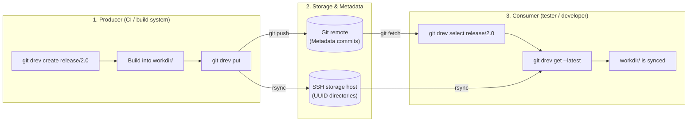

<div align="center">


# git-drev

**Lightweight directory revision manager for Git**

[](https://github.com/bvarnai/git-drev/actions/workflows/ci.yml)
[](https://github.com/bvarnai/git-drev/releases)
[](https://github.com/bvarnai/scoop-bucket)
[](go.mod)
[](LICENSE)
[](https://github.com/bvarnai/git-drev/releases)

<p align="center">
  <a href="#why-git-drev">Why git-drev?</a> •
  <a href="#the-producer--consumer-model">Producer & Consumer model</a> •
  <a href="#quick-start">Quick start</a> •
  <a href="#key-advantages">Key advantages</a> •
  <a href="#benchmark-real-world-eclipse-sdk-builds">Benchmark</a> •
  <a href="#installation">Installation</a> •
  <a href="#documentation-wiki">Documentation wiki</a>
</p>

</div>

---

## Why git-drev?

Software projects often produce large build directories that need to be shared across CI pipelines, developers, and test machines:
- **Prebuilt toolchains, sysroots, and SDKs** (large directory trees where most files stay the same between builds)
- **Java / JVM distribution bundles** with hundreds of `.jar` files where only a few change per build
- **Embedded firmware and OS root filesystems**
- **Game assets, audio banks, and compiled shaders**

Committing multi-gigabyte directories directly to Git quickly bloats the repository and slows down clones. Git LFS and cloud object stores (S3, GCS) avoid bloating Git, but they track individual files or archives rather than directory trees—meaning you still end up re-uploading or re-downloading whole files when switching versions.

**`git-drev` keeps the revision history in Git and the directory contents on a standard SSH server:**

1. **Server-side hardlinks (`cp -al`) for deduplication**
   - Each revision lives in its own `<uuid>/` directory on the SSH server.
   - Before uploading a new build, `git-drev` clones the previous revision directory on the server with `cp -al`. Unchanged files share the same underlying disk blocks, so only modified files use additional storage space.
2. **Incremental transfers (`rsync` over SSH)**
   - `git-drev` uses `rsync` over SSH to upload and download revisions, skipping unchanged files and transferring only what changed between builds.

In Git, each revision is recorded as a lightweight commit with a UUID in the subject line (`{"uuid":"...","seq":"..."}`). The Git repository stays small and fast to clone, while giving you standard branches and tags to organize builds. Because only the payload directory (`workdir`) is ignored by Git, you can also commit small files alongside each revision—such as build logs, manifests, or compiler flags—so the build metadata stays in Git even after old binary snapshots are cleaned up from the server.

---

## The Producer & Consumer model

`git-drev` is built around two roles:



1. **Producer (CI pipeline):** Creates or selects a branch (`create`), writes build outputs into `workdir/`, and publishes a new revision (`put`).
2. **Consumer (developer / tester):** Switches to a branch, tag, or specific UUID (`select`) and syncs `workdir/` (`get` or `get --latest`) without having to build from source.

---

## Quick start

### Producer workflow (e.g. CI build)
```bash
# 1. Initialize or switch to a revision branch
git drev create release/1.0

# 2. Build your large payload into the configured workdir (e.g., ./data)
mkdir -p data
make build-artifacts OUTPUT_DIR=data/

# 3. Publish the revision to remote storage & commit metadata
git drev put
```

### Consumer workflow (e.g. tester / developer)
```bash
# 1. Select the target branch (or historical UUID)
git drev select release/1.0

# 2. Download the revision snapshot into your local workdir
git drev get

# 3. Later, pull the latest upstream commits and sync workdir in one step:
git drev get --latest

# Check custom build info anytime (if .git-drev-info-hook is configured):
git drev info
```

---

## Key advantages

| Feature | `git-drev` | Git LFS | Cloud S3 / GCS |
| :--- | :--- | :--- | :--- |
| **Storage unit** | Cohesive directory trees | Individual file blobs | Individual object keys |
| **Transfer efficiency** | Incremental `rsync` transfers | Full file re-uploads | Full object re-uploads |
| **Server overhead** | Zero daemons (standard SSH + rsync) | Requires LFS HTTP server | Requires cloud IAM & custom scripts |
| **Storage deduplication** | Server-side hardlinks (`cp -al`) | Dedupes identical files only | Duplicates objects across prefixes |
| **Git clone speed** | Instant (only metadata commits in Git) | Pointer history grows with file count | N/A (external to Git) |
| **History navigation** | Native Git branches, tags, and UUIDs | Git branches track file pointers | Custom bucket versioning required |

---

## Benchmark: Real-world Eclipse SDK builds

To measure real-world transfer speed and storage deduplication, we benchmarked **5 consecutive daily [Eclipse SDK integration builds (`I-builds`)](https://download.eclipse.org/eclipse/downloads/)** (`linux-gtk-x86_64`, `I20261015-2300` through `I20261019-2300`):
- Each build archive is **273.0 MiB** compressed (`.tar.gz`) and unpacks to **302.7 MiB** (**306M** on disk across **1,368 files**, mostly OSGi `.jar` bundles and native libraries).
- Between consecutive daily builds, **~81% of files (1,091–1,124 files, ~262 MiB)** are byte-for-byte identical, while only **244–277 files (19–56 MiB)** actually change.

### Headline comparison (5 daily builds)

| Metric | Traditional (`curl` + `tar -xzf`) | `git-drev` (`select` + `get` / `put`) | Improvement |
| :--- | :--- | :--- | :--- |
| **Avg. daily update time (Consumer)** | `25.92s` (download + extract) | **`2.19s`** (`git drev select` + `get`) | **11.8x faster** |
| **Total sync time across all 5 builds** | `123.75s` (5 full downloads) | **`13.61s`** (1 cold + 4 incremental) | **9.1x faster** |
| **Avg. network payload per daily update** | `272.99 MiB` (full `.tar.gz`) | **`35.12 MiB`** (changed files/deltas only) | **87.1% less traffic** |
| **Server disk space for 5 unpacked builds** | `1,530 MB` (`5 × 306 MB` unpacked) | **`483 MB`** (`cp -al` hardlinked storage) | **68.4% less storage (`3.17x` dedup)** |
| **Server disk space vs. 5 `.tar.gz` archives** | `1,365 MB` (`5 × 273 MB` compressed) | **`483 MB`** (immediately usable directories) | **65.0% less storage than `.tar.gz`** |

### Per-build breakdown

| Build ID | Unpacked size (files) | Baseline: Download + Extract | Producer: `git drev put` (sent) | Consumer: `git drev select` + `get` (received) | Consumer speedup |
| :--- | :--- | :--- | :--- | :--- | :--- |
| `I20261015-2300` *(Cold)* | `302.7 MiB` (1,368) | `19.10s` + `0.98s` = **`20.08s`** | `5.77s` (`302.9 MiB`, 1,368 files) | **`4.84s`** (`302.9 MiB`, 1,368 files) | **4.1x faster** |
| `I20261016-2300` *(Delta)* | `302.7 MiB` (1,368) | `34.89s` + `1.01s` = **`35.90s`** | `2.40s` (`31.7 MiB`, 272 files) | **`2.15s`** (`31.7 MiB`, 272 files) | **16.7x faster** |
| `I20261017-2300` *(Delta)* | `302.7 MiB` (1,368) | `14.68s` + `0.99s` = **`15.67s`** | `2.41s` (`33.5 MiB`, 260 files) | **`2.16s`** (`33.5 MiB`, 260 files) | **7.3x faster** |
| `I20261018-2300` *(Delta)* | `302.7 MiB` (1,368) | `37.41s` + `0.99s` = **`38.40s`** | `2.17s` (`19.1 MiB`, 244 files) | **`2.03s`** (`19.1 MiB`, 244 files) | **18.9x faster** |
| `I20261019-2300` *(Delta)* | `302.7 MiB` (1,368) | `12.74s` + `0.97s` = **`13.71s`** | `2.71s` (`56.3 MiB`, 277 files) | **`2.43s`** (`56.2 MiB`, 277 files) | **5.6x faster** |
| **Total / Cumulative** | **`1,513.4 MiB`** (6,840) | **`123.75s`** (`1,364.9 MiB` `.tar.gz`) | **`15.47s`** (`443.5 MiB` total sent) | **`13.61s`** (`443.4 MiB` total received) | **9.1x faster** |

### Remote storage deduplication (`git drev usage -v`)

Even though all 5 revisions are stored as full, unpacked **306M** directory trees on the remote SSH server, `cp -al` hardlink cloning deduplicates unchanged files across revisions so the entire 5-build history consumes only **483M** on disk:

```text
$ git drev usage -v
Summary:
  Remote storage:    drs:/volume1/storage_drs/data/git-drs-benchmark
  Total space used:  483M
  Revisions found:   5

Revisions breakdown:
UUID                                      Size  Created              Commit      Branch/Tag            Message
------------------------------------  --------  -------------------  ----------  --------------------  ----------------------
0f6d2793-d87d-4dcc-9dd3-eec67425cdcf      306M  2026-10-17 01:13:29  58000a4     -                     seq: 2
62ec298a-ed76-449b-b922-76be5f584e86      306M  2026-10-20 01:12:34  4d1b2c9     main, origin/main     seq: 5
79aeba02-49df-48d9-85a1-208c3b78db77      306M  2026-10-19 01:12:05  aa5a9b9     -                     seq: 4
c5e956ec-cfcd-48e2-88f7-c7fa8f85eb8c      306M  2026-10-16 01:14:04  d78f5e8     -                     seq: 1
fe6453a6-6ba5-49c4-9821-baed6b995c18      306M  2026-10-18 01:12:36  ffc680b     -                     seq: 3
```

> [!TIP]
> **Preserving hardlinks when build pipelines reset timestamps (`-c` / `--checksum`):**
> Many nightly build and archive tools (including Eclipse's `.tar.gz` packager) touch the modification timestamp (`mtime`) of unchanged `.jar` or binary files on every build. Because default `rsync` checks `(size, mtime)`, changed timestamps on identical files will cause `rsync` to re-transfer them and break server-side `cp -al` hardlinks. Adding `-c` (`--checksum`) to `.git-drev.yaml` (`remote.rsync.put: "-c"` and `remote.rsync.get: "-c"`) instructs `rsync` to compare file checksums, preserving hardlinks for 100% of byte-identical files.

---

## Installation

> [!NOTE]
> `git-drev` requires `git`, `ssh` (OpenSSH), and `rsync` in your `$PATH`. On Windows, run inside Git Bash and install `rsync` via Scoop (`scoop install rsync`).

### Via Scoop (Windows)
```powershell
scoop bucket add bvarnai https://github.com/bvarnai/scoop-bucket
scoop install git-drev
```

### Precompiled binary (Linux / macOS)
Download the latest release archive from [GitHub Releases](https://github.com/bvarnai/git-drev/releases):
```bash
curl -sSL https://github.com/bvarnai/git-drev/releases/latest/download/git-drev_linux_amd64.tar.gz | tar -xz
sudo mv git-drev /usr/local/bin/
```

### Via Go install (Go 1.22+)
```bash
go install github.com/bvarnai/git-drev/cmd/git-drev@latest
```

Verify your installation:
```bash
git drev --version
```

---

## Configuration

Initialize a `.git-drev.yaml` configuration file in your metadata repository:

```yaml
# Directory containing active revision files (relative to repository root)
workdir: data

# Default branch used when no argument is supplied to 'select'
branch:
  default: main

# Remote storage server configuration
remote:
  host: storage-server
  path: /srv/drev/my-project
  rsync:
    get: -az --delete-during --stats
    put: -az --delete-during --whole-file --stats
```

Check your effective cascading configuration anytime with:
```bash
git drev config
```

---

## Documentation wiki

For tutorials, repository layout patterns, CI pipeline templates, and command references, see the User Guide:

- [Chapter 1: The git-drev philosophy](docs/user-guide/01-philosophy.md)
- [Chapter 2: Getting started](docs/user-guide/02-getting-started.md)
- [Chapter 3: The revision lifecycle](docs/user-guide/03-revision-lifecycle.md)
- [Chapter 4: Project hooks & CI/CD automation](docs/user-guide/04-hooks-and-ci.md)
- [Chapter 5: Storage architecture & retention](docs/user-guide/05-storage-and-retention.md)
- [Chapter 6: Complete command reference](docs/user-guide/06-command-reference.md)
- [Chapter 7: Troubleshooting & FAQ](docs/user-guide/07-troubleshooting-faq.md)

---

## Contributing

We welcome contributions! Please review our [Contributing guidelines](CONTRIBUTING.md) and [Technical specifications](docs/spec/global.md) before submitting pull requests.

---

## License

`git-drev` is open-source software licensed under the [MIT License](LICENSE).

---

## 🤖 AI Disclosure


This project was developed with the assistance of AI tools. All AI-generated code has been reviewed, tested, and manually refined.
