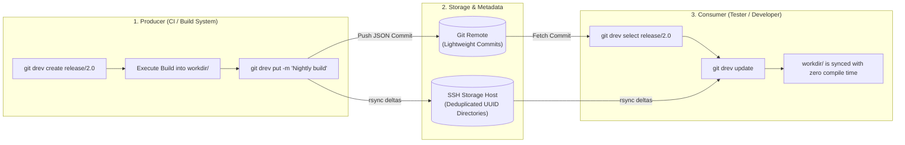

<div align="center">


# git-drev

**Minimalistic directory revision storage for Git**

[](https://github.com/bvarnai/git-drev/actions/workflows/ci.yml)
[](https://github.com/bvarnai/git-drev/releases)
[](https://github.com/bvarnai/scoop-bucket)
[](go.mod)
[](LICENSE)
[](https://github.com/bvarnai/git-drev/releases)

<p align="center">
  <a href="#why-git-drev">Why git-drev?</a> •
  <a href="#the-producer--consumer-model">Producer & Consumer Model</a> •
  <a href="#quick-start">Quick start</a> •
  <a href="#key-advantages">Key advantages</a> •
  <a href="#installation">Installation</a> •
  <a href="#user-guide-wiki">User guide wiki</a>
</p>

</div>

---

## Why git-drev?

Modern software projects often produce massive directory outputs:
- **Embedded firmware & OS root filesystems** (>5GB).
- **Machine learning checkpoints, weights, and dataset bundles**.
- **Java / JVM distribution bundles** containing hundreds of `.jar` files where only a few change between builds.
- **Game assets, audio banks, and pre-rendered textures**.

Tracking these large directory snapshots directly in Git causes immediate **repository bloat**, resulting in sluggish operations, multi-gigabyte clones, and memory thrashing. While Git LFS and cloud object stores (S3, GCS) exist, they track individual files rather than directory trees and lack **block-level delta compression**.

**`git-drev` solves this by decoupling metadata from directory data:**
- **Git** is used as a transactional, feather-light metadata database. Commits store deterministic JSON records carrying revision UUIDs and timestamps. The repository remains tiny (<10 MB) and clones in seconds.
- **Remote Storage** holds the actual files on an SSH-accessible server. Transfers leverage the battle-tested `rsync` algorithm to upload and download **only changed byte blocks**.
- **Server-Side Hardlink Cloning (`cp -al`)** duplicates the parent baseline instantly on the remote server with **zero disk space duplication**, storing only the delta between successive builds.

---

## The Producer & Consumer Model

`git-drev` organizes directory synchronization around two core roles:



1. **The Producer (CI Pipeline):** Initializes a revision branch (`create`), builds artifacts into the local working directory, and publishes the snapshot (`put`). `git-drev` clones the parent snapshot on the storage host via hardlinks, uploads changed files via rsync, and pushes a Git metadata commit with safe leasing.
2. **The Consumer (Developer / QA Tester):** Checks out the branch or exact snapshot UUID (`select`) and synchronizes the working directory (`update` or `get`). Only the byte differences between the local files and the target revision are downloaded over the network.

---

## Quick Start

### Producer Workflow (e.g. CI Build)
```bash
# 1. Initialize or switch to a revision branch
git drev create release/1.0

# 2. Build your large payload into the configured workdir (e.g., ./data)
mkdir -p data
make build-artifacts OUTPUT_DIR=data/

# 3. Publish the revision to remote storage & commit metadata
git drev put -m "feat: release 1.0 candidate payload"
```

### Consumer Workflow (e.g. Tester / Developer)
```bash
# 1. Select the target branch (or historical UUID)
git drev select release/1.0

# 2. Pull latest upstream commits and sync your local workdir
git drev update

# Your local workdir/ now has the exact byte-for-byte snapshot!
# Check revision details anytime:
git drev info
```

---

## Key Advantages

| Feature | `git-drev` | Git LFS | Cloud S3 / GCS |
| :--- | :--- | :--- | :--- |
| **Storage Unit** | Entire cohesive directory trees | Individual file blobs | Individual object keys |
| **Transfer Efficiency** | Rsync block-level deltas | Full file re-uploads | Full object re-uploads |
| **Server Overhead** | Zero background daemons (SSH + rsync) | Requires LFS HTTP API server | Requires cloud IAM & bucket orchestration |
| **Storage Deduplication** | Server-side hardlinks (`cp -al`) | Dedupes identical files only | Duplicate full storage unless custom scripted |
| **Git Clone Speed** | Instant (only metadata commits in Git) | Can still bloat pointer histories | N/A (separate tooling required) |
| **History Navigation** | Full Git branch, tag, and checkout semantics | Git branches track pointers | Custom bucket versioning required |

---

## Installation

### Via Scoop (Windows)
```powershell
scoop bucket add bvarnai https://github.com/bvarnai/scoop-bucket
scoop install git-drev
```

### Precompiled Binary (Linux / macOS)
Download the latest release archive from [GitHub Releases](https://github.com/bvarnai/git-drev/releases):
```bash
curl -sSL https://github.com/bvarnai/git-drev/releases/latest/download/git-drev_linux_amd64.tar.gz | tar -xz
sudo mv git-drev /usr/local/bin/
```

### Via Go Install (Go 1.22+)
```bash
go install github.com/bvarnai/git-drev/cmd/git-drev@latest
```

Verify your installation:
```bash
git drev --version
```

---

## Configuration

Initialize a `.git-drev.yaml` configuration file in your metadata repository:

```yaml
# Directory containing active revision files (relative to repository root)
workdir: data

# Default branch used when no argument is supplied to 'select'
branch:
  default: main

# Remote storage server configuration
remote:
  host: storage-server
  path: /srv/drev/my-project
  rsync: -aHAX --info=progress2 --delete-during
```

Check your effective cascading configuration anytime with:
```bash
git drev config
```

---

## User Guide Wiki

For in-depth tutorials, CI pipeline examples, and command references, explore the complete User Guide:

- [Chapter 1: The git-drev Philosophy](docs/user-guide/01-philosophy.md)
- [Chapter 2: Getting Started](docs/user-guide/02-getting-started.md)
- [Chapter 3: The Revision Lifecycle](docs/user-guide/03-revision-lifecycle.md)
- [Chapter 4: Project Hooks & CI/CD Automation](docs/user-guide/04-hooks-and-ci.md)
- [Chapter 5: Storage Architecture & Retention](docs/user-guide/05-storage-and-retention.md)
- [Chapter 6: Complete Command Reference](docs/user-guide/06-command-reference.md)
- [Chapter 7: Troubleshooting & FAQ](docs/user-guide/07-troubleshooting-faq.md)

---

## Contributing

We welcome contributions! Please review our [Contributing Guidelines](CONTRIBUTING.md) and [Technical Specifications](docs/spec/global.md) before submitting pull requests.

---

## License

`git-drev` is open-source software licensed under the [MIT License](LICENSE).
