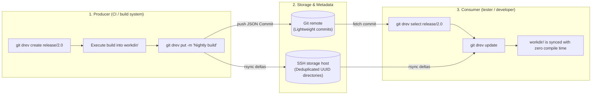

<div align="center">


# git-drev

**Minimalistic directory revision manager for Git**

[](https://github.com/bvarnai/git-drev/actions/workflows/ci.yml)
[](https://github.com/bvarnai/git-drev/releases)
[](https://github.com/bvarnai/scoop-bucket)
[](go.mod)
[](LICENSE)
[](https://github.com/bvarnai/git-drev/releases)

<p align="center">
  <a href="#why-git-drev">Why git-drev?</a> •
  <a href="#the-producer--consumer-model">Producer & Consumer model</a> •
  <a href="#quick-start">Quick start</a> •
  <a href="#key-advantages">Key advantages</a> •
  <a href="#installation">Installation</a> •
  <a href="#documentation-wiki">Documentation wiki</a>
</p>

</div>

---

## Why git-drev?

Software projects often produce massive directory outputs:
- **Prebuilt toolchains, compiler sysroots, and cross-compilation SDKs** (massive directory trees that rarely change)
- **Java / JVM distribution bundles** containing hundreds of `.jar` files where only a few change between builds
- **Embedded firmware & OS root filesystems**
- **Game assets, audio banks, and pre-rendered textures**

Tracking massive directory snapshots directly in Git causes immediate **repository bloat**, resulting in sluggish local operations and multi-gigabyte clones. While Git LFS and cloud object stores (S3, GCS) exist, they treat files in isolation and re-upload whole blobs without native directory-level delta synchronization.

**`git-drev` solves this by decoupling metadata from directory data and combining two battle-tested features:**
1. **POSIX filesystem hardlinks (`cp -al`): native off-the-shelf deduplication**
   - On standard Linux/UNIX filesystems (ext4, XFS, Btrfs, ZFS), files are represented by **inodes** pointing to physical data blocks in the storage pool. A hardlink is simply another directory entry pointing to an existing inode
   - When a new revision is created on the remote server, `git-drev` executes `cp -al <parent_uuid> <new_uuid>`. Duplicating a 10GB or 50GB directory snapshot completes in **milliseconds** and consumes **0 additional disk blocks**
   - You get enterprise-grade storage deduplication out of the box—without specialized storage appliances, background daemons, or complex snapshot engines. Only files that are modified or replaced break their hardlinks, ensuring that physical storage grows strictly by the delta between builds
2. **rsync rolling-checksum engine: true block-level delta transfers**
   - Traditional sync tools and cloud object stores re-upload or re-download entire files whenever a change occurs. `rsync` uses a rolling-checksum delta algorithm that inspects both ends, transmitting **only the modified byte ranges**
   - Identical files are skipped entirely over the wire based on size and timestamp verification. A 5GB build with 50MB of modified libraries transfers in seconds rather than minutes

`git-drev` uses a Git repository to store lightweight revision metadata, so the Git repository remains tiny (<10 MB) and clones in seconds. Because it is a standard Git repository, you can also store lightweight build logs, environment configs, or SBOM manifests alongside revisions—preserving a permanent audit trail even if remote storage snapshots are eventually pruned. Simple commands (`git drev create`, `put`, `get`, etc.) automatically resolve baselines, execute server-side actions, manage rsync sessions, and commit transactional revisions. Sharing across team members is zero-friction: you just share a Git repository.

---

## The Producer & Consumer model

`git-drev` organizes directory synchronization around two core roles:



1. **The Producer (CI pipeline):** Initializes a revision branch (`create`), builds artifacts into the local working directory, and publishes the snapshot (`put`). `git-drev` clones the parent snapshot on the storage host via hardlinks, uploads changed files via rsync, and pushes a Git metadata commit with safe leasing.
2. **The Consumer (developer / QA tester):** Checks out the branch or exact snapshot UUID (`select`) and synchronizes the working directory (`update` or `get`). Only the byte differences between the local files and the target revision are downloaded over the network.

---

## Quick start

### Producer workflow (e.g. CI build)
```bash
# 1. Initialize or switch to a revision branch
git drev create release/1.0

# 2. Build your large payload into the configured workdir (e.g., ./data)
mkdir -p data
make build-artifacts OUTPUT_DIR=data/

# 3. Publish the revision to remote storage & commit metadata
git drev put -m "feat: release 1.0 candidate payload"
```

### Consumer workflow (e.g. tester / developer)
```bash
# 1. Select the target branch (or historical UUID)
git drev select release/1.0

# 2. Pull latest upstream commits and sync your local workdir
git drev update

# Your local workdir/ now has the exact byte-for-byte snapshot!
# Check revision details anytime:
git drev info
```

---

## Key advantages

| Feature | `git-drev` | Git LFS | Cloud S3 / GCS |
| :--- | :--- | :--- | :--- |
| **Storage unit** | Entire cohesive directory trees | Individual file blobs | Individual object keys |
| **Transfer efficiency** | Rsync block-level deltas | Full file re-uploads | Full object re-uploads |
| **Server overhead** | Zero background daemons (SSH + rsync) | Requires LFS HTTP API server | Requires cloud IAM & bucket orchestration |
| **Storage deduplication** | Server-side hardlinks (`cp -al`) | Dedupes identical files only | Duplicate full storage unless custom scripted |
| **Git clone speed** | Instant (only metadata commits in Git) | Can still bloat pointer histories | N/A (separate tooling required) |
| **History navigation** | Full Git branch, tag, and checkout semantics | Git branches track pointers | Custom bucket versioning required |

---

## Installation

### Via Scoop (Windows)
```powershell
scoop bucket add bvarnai https://github.com/bvarnai/scoop-bucket
scoop install git-drev
```

### Precompiled binary (Linux / macOS)
Download the latest release archive from [GitHub Releases](https://github.com/bvarnai/git-drev/releases):
```bash
curl -sSL https://github.com/bvarnai/git-drev/releases/latest/download/git-drev_linux_amd64.tar.gz | tar -xz
sudo mv git-drev /usr/local/bin/
```

### Via Go install (Go 1.22+)
```bash
go install github.com/bvarnai/git-drev/cmd/git-drev@latest
```

Verify your installation:
```bash
git drev --version
```

---

## Configuration

Initialize a `.git-drev.yaml` configuration file in your metadata repository:

```yaml
# Directory containing active revision files (relative to repository root)
workdir: data

# Default branch used when no argument is supplied to 'select'
branch:
  default: main

# Remote storage server configuration
remote:
  host: storage-server
  path: /srv/drev/my-project
  rsync: -aHAX --info=progress2 --delete-during
```

Check your effective cascading configuration anytime with:
```bash
git drev config
```

---

## Documentation wiki

For in-depth tutorials, CI pipeline examples, and command references, explore the complete User Guide:

- [Chapter 1: The git-drev Philosophy](docs/user-guide/01-philosophy.md)
- [Chapter 2: Getting started](docs/user-guide/02-getting-started.md)
- [Chapter 3: The revision lifecycle](docs/user-guide/03-revision-lifecycle.md)
- [Chapter 4: Project hooks & CI/CD automation](docs/user-guide/04-hooks-and-ci.md)
- [Chapter 5: Storage architecture & retention](docs/user-guide/05-storage-and-retention.md)
- [Chapter 6: Complete command reference](docs/user-guide/06-command-reference.md)
- [Chapter 7: Troubleshooting & FAQ](docs/user-guide/07-troubleshooting-faq.md)

---

## Contributing

We welcome contributions! Please review our [Contributing guidelines](CONTRIBUTING.md) and [Technical specifications](docs/spec/global.md) before submitting pull requests.

---

## License

`git-drev` is open-source software licensed under the [MIT License](LICENSE).

---

## 🤖 AI Disclosure


This project was developed with the assistance of AI tools. All AI-generated code has been reviewed, tested, and manually refined.
