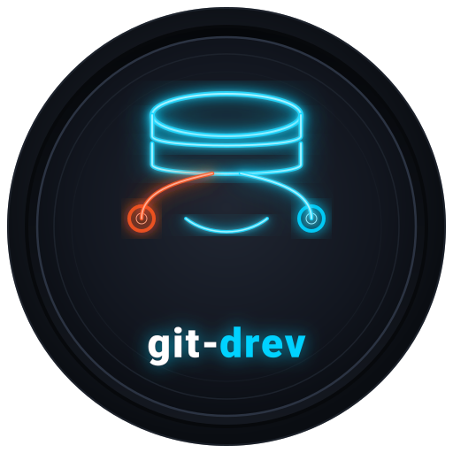
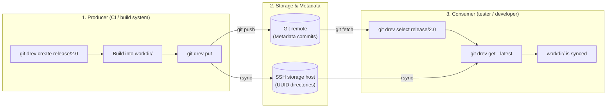

<div align="center">



# git-drev

**Lightweight directory revision manager for Git**

[](https://github.com/bvarnai/git-drev/actions/workflows/ci.yml)
[](https://github.com/bvarnai/git-drev/releases)
[](https://github.com/bvarnai/scoop-bucket)
[](go.mod)
[](LICENSE)
[](https://github.com/bvarnai/git-drev/releases)

<p align="center">
  <a href="#why-git-drev">Why git-drev?</a> •
  <a href="#the-producer--consumer-model">Producer & Consumer model</a> •
  <a href="#quick-start">Quick start</a> •
  <a href="#key-advantages">Key advantages</a> •
  <a href="#benchmark-real-world-eclipse-sdk-builds">Benchmark</a> •
  <a href="#installation">Installation</a> •
  <a href="#documentation-wiki">Documentation wiki</a>
</p>

</div>

---

## Why git-drev?

Software projects often produce large build directories that need to be shared across CI pipelines, developers, and test machines:
- **Prebuilt toolchains, sysroots, and SDKs** (large directory trees where most files stay the same between builds)
- **Java / JVM distribution bundles** with hundreds of `.jar` files where only a few change per build
- **Embedded firmware and OS root filesystems**
- **Game assets, audio banks, and compiled shaders**

Committing multi-gigabyte directories directly to Git quickly bloats the repository and slows down clones. Git LFS and cloud object stores (S3, GCS) avoid bloating Git, but they track individual files or archives rather than directory trees—meaning you still end up re-uploading or re-downloading whole files when switching versions.

**`git-drev` keeps the revision history in Git and the directory contents on a standard SSH server:**

1. **Server-side hardlinks (`cp -al`) for deduplication**
   - Each revision lives in its own `<uuid>/` directory on the SSH server.
   - Before uploading a new build, `git-drev` clones the previous revision directory on the server with `cp -al`. Unchanged files share the same underlying disk blocks, so only modified files use additional storage space.
2. **Incremental transfers (`rsync` over SSH)**
   - `git-drev` uses `rsync` over SSH to upload and download revisions, skipping unchanged files and transferring only what changed between builds.

In Git, each revision is recorded as a lightweight commit with a UUID in the subject line (`{"uuid":"...","seq":"..."}`). The Git repository stays small and fast to clone, while giving you standard branches and tags to organize builds. Because only the payload directory (`workdir`) is ignored by Git, you can also commit small files alongside each revision—such as build logs, manifests, or compiler flags—so the build metadata stays in Git even after old binary snapshots are cleaned up from the server.

---

## The Producer & Consumer model

`git-drev` is built around two roles:



1. **Producer (CI pipeline):** Creates or selects a branch (`create`), writes build outputs into `workdir/`, and publishes a new revision (`put`).
2. **Consumer (developer / tester):** Switches to a branch, tag, or specific UUID (`select`) and syncs `workdir/` (`get` or `get --latest`) without having to build from source.

> [!TIP]
> **SSH key management:** You do not need to provision separate SSH keys on the server for every client unless you want to. For maximum safety and zero per-developer onboarding overhead, teams typically assign a dedicated **read-write** SSH key/account to the **Producer** (CI) and let **Consumers** share a single **read-only** SSH key/account.

---

## Quick start

### Repository initialization (one-time setup)
```bash
# In a fresh directory, bootstrap a dedicated git-drev repository:
git drev init --host storage-server --path /srv/drev/{repo}
```

### Producer workflow (e.g. CI build)
```bash
# 1. Initialize or switch to a revision branch
git drev create release/1.0

# 2. Build your large payload into the configured workdir (e.g., ./data)
mkdir -p data
make build-artifacts OUTPUT_DIR=data/

# 3. Publish the revision to remote storage & commit metadata
git drev put
```

### Consumer workflow (e.g. tester / developer)
```bash
# 1. Select the target branch (or historical UUID)
git drev select release/1.0

# 2. Download the revision snapshot into your local workdir
git drev get

# 3. Later, pull the latest upstream commits and sync workdir in one step:
git drev get --latest

# Check custom build info anytime (if .git-drev-info-hook is configured):
git drev info
```

---

## Key advantages

| Feature | `git-drev` | Git LFS | Cloud S3 / GCS |
| :--- | :--- | :--- | :--- |
| **Storage unit** | Cohesive directory trees | Individual file blobs | Individual object keys |
| **Transfer efficiency** | Incremental `rsync` transfers | Full file re-uploads | Full object re-uploads |
| **Server overhead** | Zero daemons (standard SSH + rsync) | Requires LFS HTTP server | Requires cloud IAM & custom scripts |
| **Storage deduplication** | Server-side hardlinks (`cp -al`) | Dedupes identical files only | Duplicates objects across prefixes |
| **Git clone speed** | Instant (only metadata commits in Git) | Pointer history grows with file count | N/A (external to Git) |
| **History navigation** | Native Git branches, tags, and UUIDs | Git branches track file pointers | Custom bucket versioning required |

---

## Benchmark: Real-world Eclipse SDK builds

Across **5 consecutive daily [Eclipse SDK integration builds (`I-builds`)](https://download.eclipse.org/eclipse/downloads/)** (`linux-gtk-x86_64`, **306 MB unpacked** / **273 MB `.tar.gz`** across **1,368 files** per build, where ~81% of files remain identical day-to-day):

| Metric | Traditional (`curl` + `tar -xzf`) | `git-drev` (`select` + `get` / `put`) | Improvement |
| :--- | :--- | :--- | :--- |
| **Avg. daily update time (Consumer)** | `25.92s` (download + extract) | **`2.19s`** (`git drev select` + `get`) | **11.8x faster** |
| **Total sync time across all 5 builds** | `123.75s` (5 full downloads) | **`13.61s`** (1 cold + 4 incremental) | **9.1x faster** |
| **Avg. network payload per daily update** | `272.99 MiB` (full `.tar.gz`) | **`35.12 MiB`** (changed files/deltas only) | **87.1% less traffic** |
| **Server disk space for 5 unpacked builds** | `1,530 MB` (`5 × 306 MB` unpacked) | **`483 MB`** (`cp -al` hardlinked storage) | **68.4% less storage (`3.17x` dedup)** |
| **Server disk space vs. 5 `.tar.gz` archives** | `1,365 MB` (`5 × 273 MB` compressed) | **`483 MB`** (immediately usable directories) | **65.0% less storage than `.tar.gz`** |

See [Chapter 5: Storage architecture & retention](docs/user-guide/storage-and-retention.md#6-real-world-benchmark-eclipse-sdk-builds) for the full per-build breakdown and `git drev usage -a` analysis.

---

## Installation

> [!NOTE]
> - **Client (`git-drev` CLI):** Supported on **Linux**, **macOS**, and **Windows** (inside Git Bash). Requires `git`, `ssh` (OpenSSH), and `rsync` in your `$PATH`. On Windows, install `rsync` via Scoop (`scoop install rsync`).
> - **Storage server (`remote.host`):** Requires a **Linux** (or Linux-compatible) SSH server with `sshd`, `rsync`, and GNU coreutils (`cp -al`, `du -sh`, `stat -c %Y`, `rm -rf`).

### Via Scoop (Windows)
```powershell
scoop bucket add bvarnai https://github.com/bvarnai/scoop-bucket
scoop install git-drev
```

### Precompiled binary (Linux / macOS)
Download the latest release archive from [GitHub Releases](https://github.com/bvarnai/git-drev/releases):
```bash
curl -sSL https://github.com/bvarnai/git-drev/releases/latest/download/git-drev_linux_amd64.tar.gz | tar -xz
sudo mv git-drev /usr/local/bin/
```

### Via Go install (Go 1.22+)
```bash
go install github.com/bvarnai/git-drev/cmd/git-drev@latest
```

Verify your installation:
```bash
git drev --version
```

---

## Configuration

Initialize a `.git-drev.yaml` configuration file in your metadata repository:

```yaml
# Directory containing active revision files (optional, defaults to "data")
workdir: data

# Default branch when no argument is supplied to 'select' (optional, defaults to "main")
branch:
  default: main

# Remote storage server configuration
remote:
  host: storage-server
  path: /srv/drev/my-project
  rsync:
    get: -c
    put: -c
```

> [!IMPORTANT]
> **Choosing whether to include `-c` (`--checksum`):**
> `git-drev` does not force `-c` by default because checksummed transfers require reading every file from disk on both client and server. Choose based on how your files are produced:
> - **CI / clean builds & unpacked archives (`get: -c`, `put: -c` — recommended):** Clean builds and archive tools (`tar`, Maven/Gradle) update `mtime` on every file even when 80–90% of the output is byte-identical. Without `-c`, `rsync` treats every file with a new timestamp as modified, re-uploads it, and **breaks the server-side `cp -al` hardlinks** (destroying storage deduplication).
> - **Incremental local builds & static datasets (omit `-c`):** If your workflow preserves modification timestamps on unchanged files (or manages multi-gigabyte media trees where hashing every file is too slow), omit `-c` so `rsync` uses its instant `(size, mtime)` check.

Check your effective cascading configuration anytime with:
```bash
git drev config
```

---

## Documentation wiki

For tutorials, repository layout patterns, CI pipeline templates, and command references, see the User Guide:

- [Chapter 1: The git-drev philosophy](docs/user-guide/philosophy.md)
- [Chapter 2: Getting started](docs/user-guide/getting-started.md)
- [Chapter 3: The revision lifecycle](docs/user-guide/revision-lifecycle.md)
- [Chapter 4: Project hooks & CI/CD automation](docs/user-guide/hooks-and-ci.md)
- [Chapter 5: Storage architecture & retention](docs/user-guide/storage-and-retention.md)
- [Chapter 6: Complete command reference](docs/user-guide/command-reference.md)
- [Chapter 7: Troubleshooting & FAQ](docs/user-guide/troubleshooting-faq.md)

Ready-to-use AI coding assistant integrations are also included in [`templates/rules/git-drev.md`](templates/rules/git-drev.md) and [`templates/skills/git-drev/SKILL.md`](templates/skills/git-drev/SKILL.md).

---

## Contributing

We welcome contributions! Please review our [Contributing guidelines](CONTRIBUTING.md) and [Technical specifications](docs/spec/global.md) before submitting pull requests.

---

## License

`git-drev` is open-source software licensed under the [MIT License](LICENSE).

---

## 🤖 AI Disclosure


This project was developed with the assistance of AI tools. All AI-generated code has been reviewed, tested, and manually refined.
