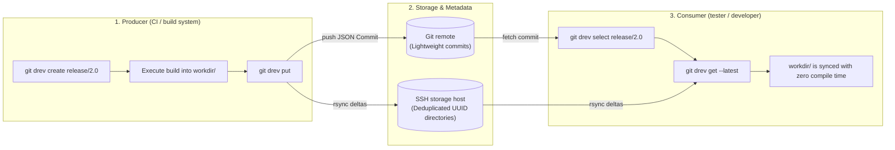

<div align="center">


# git-drev

**Minimalistic directory revision manager for Git**

[](https://github.com/bvarnai/git-drev/actions/workflows/ci.yml)
[](https://github.com/bvarnai/git-drev/releases)
[](https://github.com/bvarnai/scoop-bucket)
[](go.mod)
[](LICENSE)
[](https://github.com/bvarnai/git-drev/releases)

<p align="center">
  <a href="#why-git-drev">Why git-drev?</a> •
  <a href="#the-producer--consumer-model">Producer & Consumer model</a> •
  <a href="#quick-start">Quick start</a> •
  <a href="#key-advantages">Key advantages</a> •
  <a href="#installation">Installation</a> •
  <a href="#documentation-wiki">Documentation wiki</a>
</p>

</div>

---

## Why git-drev?

Software projects often produce large directory outputs that need to be shared across CI pipelines, developers, and test rigs:
- **Prebuilt toolchains, compiler sysroots, and cross-compilation SDKs** (large directory trees where most files remain unchanged across builds)
- **Java / JVM distribution bundles** containing hundreds of `.jar` files where only a few change between builds
- **Embedded firmware & OS root filesystems**
- **Game assets, audio banks, and pre-rendered textures**

Tracking multi-gigabyte directories directly in Git causes immediate **repository bloat**, leading to sluggish local operations and slow clones. While Git LFS and cloud object stores (S3, GCS) exist, they track individual blobs in isolation and re-upload whole files without directory-level delta synchronization.

**`git-drev` decouples revision metadata from directory payloads using two standard UNIX primitives:**
1. **POSIX filesystem hardlinks (`cp -al`): zero-copy server baselines**
   - On standard Linux/UNIX filesystems (`ext4`, `XFS`, `Btrfs`, `ZFS`), a hardlink is simply a new directory entry pointing to an existing inode.
   - Before uploading a new revision, `git-drev` clones the parent snapshot on the storage host with `cp -al -- <parent_uuid> <new_uuid>`. Cloning a 50 GB directory tree finishes in milliseconds and consumes **zero additional data blocks**.
   - Unchanged files share inodes across revisions, while modified files are atomically unlinked and replaced—so physical disk usage grows strictly by the delta between builds.
2. **rsync rolling-checksum engine: block-level network transfers**
   - Instead of re-uploading or re-downloading entire archives when a few files change, `rsync` compares file sizes and timestamps and transmits **only modified files and byte ranges**.
   - A 5 GB build with 50 MB of updated libraries transfers in seconds over standard SSH.

`git-drev` stores each revision as a tiny JSON commit (`{"uuid":"...","seq":"..."}`) in a dedicated Git metadata repository (often mounted as a submodule in your source tree). Because the Git repository only tracks metadata, it stays under a few megabytes and clones instantaneously—and you can optionally commit lightweight build logs, manifests, or SBOMs alongside each revision for a permanent audit trail.

---

## The Producer & Consumer model

`git-drev` organizes directory synchronization around two roles:



1. **The Producer (CI pipeline):** Initializes a revision branch (`create`), builds artifacts into the working directory, and publishes the snapshot (`put`). `git-drev` hardlink-clones the parent revision on the storage host, uploads changed files via `rsync`, and pushes a Git metadata commit with optimistic concurrency control.
2. **The Consumer (developer / QA tester):** Selects a branch, tag, or exact revision UUID (`select`) and synchronizes the working directory (`get`, or `get --latest` to update the branch and download in one step). Only the byte differences between the local directory and the target revision are downloaded.

---

## Quick start

### Producer workflow (e.g. CI build)
```bash
# 1. Initialize or switch to a revision branch
git drev create release/1.0

# 2. Build your large payload into the configured workdir (e.g., ./data)
mkdir -p data
make build-artifacts OUTPUT_DIR=data/

# 3. Publish the revision to remote storage & commit metadata
git drev put
```

### Consumer workflow (e.g. tester / developer)
```bash
# 1. Select the target branch (or historical UUID)
git drev select release/1.0

# 2. Download the revision snapshot into your local workdir
git drev get

# 3. Later, pull the latest upstream commits and sync workdir in one step:
git drev get --latest

# Check custom build info anytime (if .git-drev-info-hook is configured):
git drev info
```

---

## Key advantages

| Feature | `git-drev` | Git LFS | Cloud S3 / GCS |
| :--- | :--- | :--- | :--- |
| **Storage unit** | Cohesive directory trees | Individual file blobs | Individual object keys |
| **Transfer efficiency** | Rsync block-level deltas | Full file re-uploads | Full object re-uploads |
| **Server overhead** | Zero daemons (standard SSH + rsync) | Requires LFS HTTP server | Requires cloud IAM & custom scripts |
| **Storage deduplication** | Server-side hardlinks (`cp -al`) | Dedupes identical files only | Duplicates objects across prefixes |
| **Git clone speed** | Instant (only metadata commits in Git) | Pointer history grows with file count | N/A (external to Git) |
| **History navigation** | Native Git branches, tags, and UUIDs | Git branches track file pointers | Custom bucket versioning required |

---

## Installation

> [!NOTE]
> `git-drev` requires `git`, `ssh` (OpenSSH), and `rsync` in your `$PATH`. On Windows, run inside Git Bash and install `rsync` via Scoop (`scoop install rsync`).

### Via Scoop (Windows)
```powershell
scoop bucket add bvarnai https://github.com/bvarnai/scoop-bucket
scoop install git-drev
```

### Precompiled binary (Linux / macOS)
Download the latest release archive from [GitHub Releases](https://github.com/bvarnai/git-drev/releases):
```bash
curl -sSL https://github.com/bvarnai/git-drev/releases/latest/download/git-drev_linux_amd64.tar.gz | tar -xz
sudo mv git-drev /usr/local/bin/
```

### Via Go install (Go 1.22+)
```bash
go install github.com/bvarnai/git-drev/cmd/git-drev@latest
```

Verify your installation:
```bash
git drev --version
```

---

## Configuration

Initialize a `.git-drev.yaml` configuration file in your metadata repository:

```yaml
# Directory containing active revision files (relative to repository root)
workdir: data

# Default branch used when no argument is supplied to 'select'
branch:
  default: main

# Remote storage server configuration
remote:
  host: storage-server
  path: /srv/drev/my-project
  rsync:
    get: -az --delete-during --stats
    put: -az --delete-during --whole-file --stats
```

Check your effective cascading configuration anytime with:
```bash
git drev config
```

---

## Documentation wiki

For tutorials, repository layout patterns, CI pipeline templates, and command references, see the User Guide:

- [Chapter 1: The git-drev philosophy](docs/user-guide/01-philosophy.md)
- [Chapter 2: Getting started](docs/user-guide/02-getting-started.md)
- [Chapter 3: The revision lifecycle](docs/user-guide/03-revision-lifecycle.md)
- [Chapter 4: Project hooks & CI/CD automation](docs/user-guide/04-hooks-and-ci.md)
- [Chapter 5: Storage architecture & retention](docs/user-guide/05-storage-and-retention.md)
- [Chapter 6: Complete command reference](docs/user-guide/06-command-reference.md)
- [Chapter 7: Troubleshooting & FAQ](docs/user-guide/07-troubleshooting-faq.md)

---

## Contributing

We welcome contributions! Please review our [Contributing guidelines](CONTRIBUTING.md) and [Technical specifications](docs/spec/global.md) before submitting pull requests.

---

## License

`git-drev` is open-source software licensed under the [MIT License](LICENSE).

---

## 🤖 AI Disclosure


This project was developed with the assistance of AI tools. All AI-generated code has been reviewed, tested, and manually refined.
