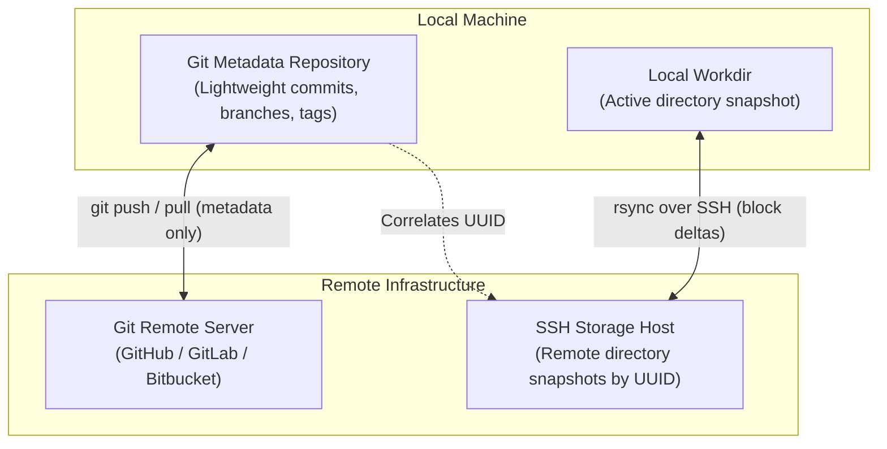
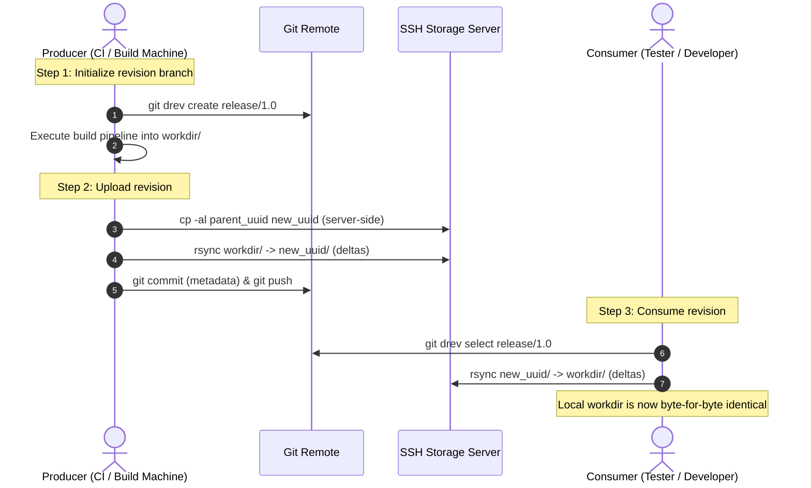

# Chapter 1: The git-drev Philosophy

`git-drev` (Directory Revision Storage) is a lightweight Git CLI extension designed to manage and synchronize large directory snapshots efficiently without bloating your Git repository.

---

## The Problem: Large Build Artifacts in Git

Modern software engineering frequently involves large directory artifacts:
- Embedded firmware images and cross-compiled root filesystems (>5GB).
- Prebuilt toolchains, compiler sysroots, and cross-compilation SDKs (massive directory trees that rarely change).
- Java application builds containing hundreds of third-party `.jar` dependencies where only 1 or 2 change between builds.
- Game engine asset directories and pre-rendered textures.

Attempting to track these directory snapshots in standard Git repositories quickly leads to catastrophic repository bloat:
1. **Cloning slowdown:** Git stores the complete history of every version in `.git/objects`. A few 5GB builds turn a clone into an hours-long, multi-gigabyte download.
2. **Poor delta compression:** Git's packfile delta compression is designed for text files and small objects; packing massive multi-gigabyte binary directories causes high memory usage and packfile thrashing.
3. **Git LFS and S3 overhead:** 
   - Git LFS tracks individual files rather than cohesive directory trees. When hundreds of files change slightly across builds, LFS still re-uploads entire files without block-level delta compression.
   - Cloud blob storage (Amazon S3, Google Cloud Storage) lacks native block-level delta synchronization, requiring full object uploads/downloads and custom orchestration scripts.

---

## The Core Concept: Metadata in Git, Data on Remote Storage

`git-drev` solves this by decoupling **metadata** from **data**:



1. **Git as a Transactional Metadata Database:**
   - Every directory revision is assigned an RFC 4122 UUID (`018f24a0-7b32-7e9b-a012-3456789abcde`).
   - Git commits carry pure JSON metadata in their commit subjects:
     ```json
     {"uuid":"018f24a0-7b32-7e9b-a012-3456789abcde","timestamp":"2026-10-19 10:00:00","author":"ci-builder","message":"Nightly build #42"}
     ```
   - The Git repository stays feather-light (under 10 megabytes), cloning in seconds.
   - **Permanent Build Provenance:** Because `workdir/` is the only ignored path in `.gitignore`, any lightweight text or metadata files placed in the repository (such as `build.log`, `manifest.json`, compiler options, or SBOMs) are staged and committed directly into Git. Even if a remote 50GB binary snapshot is eventually purged by retention cleanup scripts months later, the Git repository permanently retains the complete build recipe, logs, and audit trail needed to reproduce the build.

2. **POSIX Filesystem Hardlinks (`cp -al`): Native Off-the-Shelf Deduplication:**
   - On standard Linux/UNIX filesystems (ext4, XFS, Btrfs, ZFS), files are represented by **inodes** pointing to physical data blocks in the storage pool. A hardlink is simply another directory entry pointing to an existing inode.
   - When a new revision is created on the remote server, `git-drev` executes `cp -al <parent_uuid> <new_uuid>`. Duplicating a 10GB or 50GB directory snapshot completes in **milliseconds** and consumes **0 additional disk blocks**.
   - You get enterprise-grade storage deduplication out of the box—without specialized storage appliances, background daemons, or complex snapshot engines. Only files that are modified or replaced break their hardlinks, ensuring that physical storage grows strictly by the delta between builds.

3. **rsync Rolling-Checksum Engine: True Block-Level Delta Transfers:**
   - Traditional sync tools and cloud object stores re-upload or re-download entire files whenever a change occurs. `rsync` uses a rolling-checksum delta algorithm that inspects both ends, transmitting **only the modified byte ranges**.
   - Identical files are skipped entirely over the wire based on size and timestamp verification. A 5GB build with 50MB of modified libraries transfers in seconds rather than minutes.

---

## The Producer & Consumer Paradigm

`git-drev` workflows are structured around two distinct operational roles:



### The Producer (CI / Release Automation)
- Runs in headless CI pipelines (Jenkins, GitHub Actions, GitLab CI).
- Automatically creates branches via `git drev create <branch>`.
- Executes compilation or packaging to populate the local `workdir`.
- Publishes snapshots via `git drev put -m "Build details"`.
- Interacts with project hooks (`.git-drev-put-hook`) to inject CI build metadata into commit records.

### The Consumer (Tester / Developer)
- Developers or QA engineers who need to test exact builds without recompiling.
- Switches between builds instantly via `git drev select <branch>|<uuid>`.
- Synchronizes the local working directory via `git drev update` or `git drev get`.
- Only changed files are fetched over the network; if 95% of dependencies are identical to the previous build, only 5% of data is downloaded.

---

## Guiding Principles

1. **Zero Daemon Overhead:** No custom servers, daemons, or background agents. `git-drev` uses standard `git`, OpenSSH (`ssh`), and `rsync`.
2. **POSIX & Cross-Platform Integrity:** Built with Go 1.22+, supporting Linux, macOS, and Windows (Git Bash).
3. **Deterministic & Safe:** All Git mutations validate working tree state and index locks; all pushes use safe leasing; all subprocesses respect strict cancellation timeouts.
4. **Transparent Retention:** Server-side revisions are simple directories named after UUIDs (`<path>/<uuid>`). Correlating active versus orphaned revisions is easily inspected with `git drev usage -v`.
