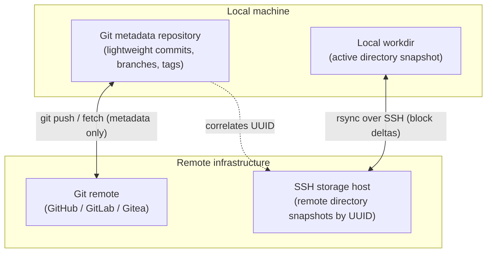
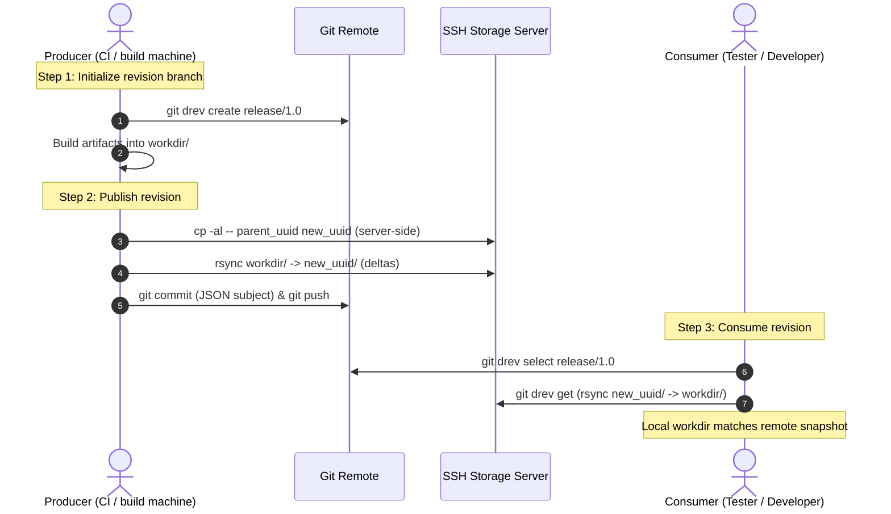

# Chapter 1: The git-drev philosophy

`git-drev` is a Git CLI extension that versions and synchronizes large directory trees using Git for revision metadata and SSH + `rsync` for storage and transfer.

---

## The problem: large build directories in Git

Many engineering workflows produce directory trees that are too large for standard Git but still need branch, tag, and commit semantics:
- **Embedded firmware images and OS root filesystems** (often 2–20 GB per build)
- **Prebuilt toolchains, sysroots, and cross-compilation SDKs** (tens of thousands of header and library files that rarely change between releases)
- **JVM / Java application bundles** containing hundreds of `.jar` archives where only a handful change per build
- **Game engine asset trees, audio banks, and compiled shaders**

Tracking these directories directly in Git degrades repository performance:
1. **Slow clones and fetches:** Git stores every historical blob inside `.git/objects`. A few multi-gigabyte builds turn `git clone` into a slow, bandwidth-heavy download.
2. **Packfile thrashing:** Git's packfile compression is tuned for source code; repacking multi-gigabyte binary trees consumes gigabytes of RAM and CPU time.
3. **Why Git LFS and S3 fall short for directory trees:**
   - **Git LFS** versions individual files rather than cohesive directory snapshots. When files change slightly, LFS transfers full file blobs without block-level delta compression.
   - **Cloud object stores (S3, GCS)** treat every file as an independent object key. Without a custom manifest tool, you have to tar/untar archives or re-upload unchanged files on every build.

---

## The core concept: metadata in Git, data on remote storage

`git-drev` splits directory versioning into two layers:



1. **Git as the revision ledger:**
   - Each published directory snapshot is assigned an RFC 4122 UUID (`018f24a0-7b32-7e9b-a012-3456789abcde`).
   - `git drev put` creates a commit whose subject is a compact JSON string (while Git natively records the author and timestamp in the commit header):
     ```json
     {"uuid":"018f24a0-7b32-7e9b-a012-3456789abcde","seq":"1729332000"}
     ```
   - Because the working directory (`workdir`) is ignored via `.gitignore`, the Git repository stays under a few megabytes regardless of how many terabytes of builds are published.
   - **Permanent build provenance:** Any small files placed outside `workdir/`—such as `build.log`, compiler flags, test summaries, or SBOMs—are staged (`git add --all`) and committed alongside the revision UUID. Even after old binary snapshots are pruned from the storage server, the Git history permanently preserves the build logs and metadata.

2. **Server-side deduplication via POSIX hardlinks (`cp -al`):**
   - Before uploading a new revision, `git-drev` checks the UUID of the parent commit on the active branch and runs `cp -al -- <parent_uuid> <new_uuid>` on the storage server.
   - Because hardlinks only create directory entries pointing to existing inodes, cloning a 50 GB baseline takes milliseconds and uses zero additional data blocks.
   - When `rsync` uploads the new build, unchanged files are untouched (keeping their shared inodes), while modified files are written to temporary files and atomically renamed into place.

3. **Network delta transfer via `rsync`:**
   - Both `put` (upload) and `get` (download) stream changes over SSH using `rsync`.
   - If a Consumer switches from build `#101` to build `#102` and 95% of the files are identical, `rsync` skips the unchanged files and transfers only the 5% that changed.

---

## Repository topology: dedicated repo vs. Git submodule

> [!IMPORTANT]
> **Do not run `git-drev` directly inside your primary source-code branch.**
> Because `git drev put`, `update`, and `select` manage their own commit subjects (`{"uuid":"...","seq":"..."}`) and use `git reset --hard` / `git rebase -X theirs` to synchronize state, `git-drev` should always live in a **dedicated metadata repository**.

Teams typically use one of two layouts:

1. **Standalone artifact repository (simplest for QA / test teams):**
   - A dedicated Git repository (e.g., `myproject-builds.git`) containing `.git-drev.yaml`, optional hooks (`.git-drev-put-hook`, `.git-drev-info-hook`), and the ignored `workdir/` (`data/`).
   - CI pipelines push new build revisions to `myproject-builds.git`, and testers clone `myproject-builds.git` to pull ready-to-run builds without needing source code or compilers.
2. **Git submodule inside your source repository (best for prebuilt SDKs / toolchains):**
   - Add the `git-drev` metadata repository as a Git submodule inside your main source tree (for example, at `third_party/sdk/`).
   - Developers clone the source repository, run `git drev get` inside `third_party/sdk/` to fetch the prebuilt toolchain, and pin the exact SDK revision in the parent source repo using standard submodule commits.

---

## The Producer & Consumer workflow



### The Producer (CI / build automation)
- Runs in CI pipelines (Jenkins, GitHub Actions, GitLab CI).
- Creates or switches to target branches with `git drev create <branch>`.
- Compiles or packages artifacts into `workdir`.
- Publishes snapshots with `git drev put` (optionally passing `-s <sequence>` to attach a monotonic CI build number) and uses `.git-drev-put-hook` to record build metadata.

### The Consumer (developer / QA engineer)
- Pulls prebuilt artifacts without compiling locally.
- Switches between branches, tags, or historical UUIDs with `git drev select [<branch>|<tag>|<uuid>]`.
- Downloads the snapshot into `workdir` with `git drev get`, or runs `git drev get --latest` (`-l`) to update the active branch from `origin` and download in one command.

---

## Design principles

1. **No custom server daemons:** Requires only standard `git`, OpenSSH (`ssh`), and `rsync` on the client, and `sshd`, `rsync`, and POSIX `cp` / `du` on the storage host.
2. **Cross-platform client:** Written in Go 1.22+ with zero external runtime dependencies beyond `git`, `ssh`, and `rsync`; runs on Linux, macOS, and Windows (Git Bash).
3. **Transactional safety:** All mutating commands check worktree state and `.git/index.lock` before running, push with `--force-with-lease`, and clean up incomplete remote staging directories if interrupted (`SIGINT` / `SIGTERM`).
4. **Simple retention:** Remote revisions are plain `<path>/<uuid>/` directories on disk. Auditing active vs. orphaned snapshots takes a single command (`git drev usage -v`).
