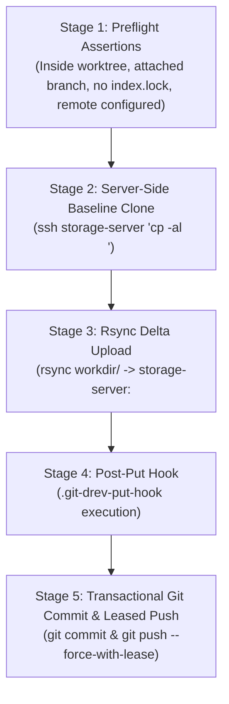

# Chapter 3: The Revision lifecycle

This chapter covers the complete day-to-day lifecycle of directory revisions in `git-drev`: creating revision branches, publishing snapshots, synchronizing updates, and switching between historical versions.

---

## 1. Revision anatomy & metadata format

Unlike standard Git commits that store tracked directory tree blobs, `git-drev` revision commits are lightweight metadata records. Each commit subject contains a deterministic JSON payload:

```json
{
  "uuid": "4a123f89-8d7b-4b10-8f6a-49321ef19b12",
  "sequence": 4,
  "timestamp": "2026-10-19 14:30:00",
  "author": "ci-builder <ci@example.com>",
  "message": "release 2.1.0 build with optimized assets"
}
```

- **`uuid`:** RFC 4122 canonical UUID identifying the exact directory snapshot stored at `<remote.path>/<uuid>` on the storage host
- **`sequence`:** Monotonically increasing revision counter within the branch, tracking total commits since branch creation
- **`message`:** Human-readable description supplied via `git drev put -m "<message>"`
- **Marker Commits:** When a branch is first initialized via `git drev create`, an initial marker commit is created with `sequence: 0`. The marker stores the parent revision's UUID (or `00000000-0000-0000-0000-000000000000` if unborn) to establish the baseline linkage for future `cp -al` server clones

---

## 2. Creating a revision branch (`create`)

Before publishing revisions for a new release or feature, initialize a branch:

```bash
git drev create release/2.0
```

### What happens under the hood
1. **Local check:** Checks if `refs/heads/release/2.0` already exists locally. If so, fetches and checks it out
2. **Remote check:** Checks if `refs/remotes/origin/release/2.0` exists on `origin`. If so, creates a local tracking branch and switches to it
3. **New branch initialization:** If the branch does not exist anywhere:
   - Reads the UUID of the current `HEAD` commit
   - Creates a marker commit on the new branch recording the parent revision UUID
   - Pushes the new branch and marker commit to `origin`

```
* (release/2.0) [Marker Commit: Parent UUID = 4a123f89-...]
|
* (main) [Revision 3: UUID = 4a123f89-...]
```

---

## 3. Publishing revisions (`put`)

The `put` command is the workhorse of the Producer (CI or build system). It uploads the current contents of `workdir` to the remote storage host and commits the new revision metadata to Git:

```bash
# Populate or update your build output in workdir/
make build-all-artifacts

# Publish the revision
git drev put -m "feat: compiled binaries and assets for v2.0-rc1"
```

### The 5-Stage publishing Flow



1. **Preflight assertions:** Verifies that `HEAD` is attached to a valid branch, no `.git/index.lock` exists, and the remote host is reachable
2. **Server-Side hardlink clone:**
   - If a parent revision UUID exists on the branch, `git-drev` executes `cp -al <parent_uuid> <new_uuid>` directly on the remote server
   - This creates an instant duplicate of the previous build in milliseconds without consuming disk space
3. **Rsync delta upload:**
   - Runs `rsync` from your local `workdir` to the remote `<path>/<new_uuid>` directory
   - Only new or modified files/blocks are transmitted across the network. Unmodified files remain hardlinked
4. **Project hook execution:**
   - If `.git-drev-put-hook` exists in the repository root, it executes with `GIT_DREV_*` environment variables injected (see [Chapter 4](04-hooks-and-ci.md))
5. **Transactional commit & push:**
   - Records the revision metadata commit in Git
   - Pushes to `origin` using `--force-with-lease`
   - **Stale-Push Auto-Rebase:** If another builder pushed a revision in the meantime, `git-drev` automatically fetches, rebases linearly on top of upstream, and retries the push up to 3 times

---

## 4. Fetching upstream updates (`update`)

For Consumers collaborating on an active branch, `update` pulls new revisions from `origin` and synchronizes the local `workdir` to the latest snapshot:

```bash
git drev update
```

### What happens under the hood
1. Executes `git fetch origin <current-branch>`
2. Fast-forwards the local branch to match `origin`
3. Resolves the latest revision UUID from the new `HEAD` commit
4. Executes `rsync` from `storage-server:<path>/<uuid>/` into your local `workdir/`

---

## 5. Downloading snapshot content (`get`)

If your Git repository is already at the desired commit (for example, after switching branches with `git checkout` or checking out a tag), synchronize the local `workdir` with `get`:

```bash
git drev get
```

`git-drev get` reads the UUID from the current `HEAD` commit metadata and runs `rsync` to download the corresponding directory snapshot into `workdir`.

---

## 6. Switching revisions (`select`)

`select` checks out an existing branch, tag, or specific historical revision commit resolved by UUID:

```bash
# Select by branch name
git drev select feature/embedded-ui

# Select default branch (configured in .git-drev.yaml, default 'main')
git drev select

# Select by exact revision UUID (detaches HEAD to the specific commit)
git drev select 4a123f89-8d7b-4b10-8f6a-49321ef19b12
```

### Typo suggestions
If you make a typo when entering a branch name, `git-drev` computes the Levenshtein distance against existing branches and tags and suggests the closest candidate:

```
$ git drev select featrue/login
[git-drev] Error: Checkout failed (git checkout featrue/login)
[git-drev] Hint: Did you mean 'feature/login'?
```

---

## 7. Inspecting revisions & storage status

### Current revision info (`info`)
Displays the revision metadata of the active `HEAD` commit:

```bash
git drev info
```
Output:
```
Commit:    a7b8c9d0123456789abcdef0123456789abcdef0
Branch:    release/2.0
UUID:      4a123f89-8d7b-4b10-8f6a-49321ef19b12
Sequence:  4
Timestamp: 2026-10-19 14:30:00
Author:    ci-builder <ci@example.com>
Message:   feat: compiled binaries and assets for v2.0-rc1
```

For machine-parseable scripts, use `-s` (`--short`) to output only the revision sequence or `--uuid` for the raw UUID:
```bash
git drev info -s
# 4
```

### Current branch name (`name`)
Prints the current branch name (or indicates detached `HEAD`):
```bash
git drev name
# release/2.0
```

### Remote storage usage (`usage`)
Queries the remote storage host to report total disk space consumed by stored revisions:
```bash
git drev usage
```
Add `-v` (`--verbose`) to correlate all remote UUID directories against local Git history, revealing active versus orphaned snapshots:
```bash
git drev usage -v
```
Output:
```
UUID                                  Size      State       Branch / Tag
------------------------------------  --------  ----------  -------------------
4a123f89-8d7b-4b10-8f6a-49321ef19b12  4.2 GB    active      release/2.0
9f8e7d6c-5b4a-3a21-10fe-dcba98765432  120 MB    active      main
01234567-89ab-cdef-0123-456789abcdef  3.8 GB    [orphaned]  (no git ref)
------------------------------------  --------  ----------  -------------------
Total Storage Consumed: 8.12 GB (3 revisions)
```
*(See [Chapter 5: Storage and Retention](05-storage-and-retention.md) for automated cleanup of orphaned revisions).*
