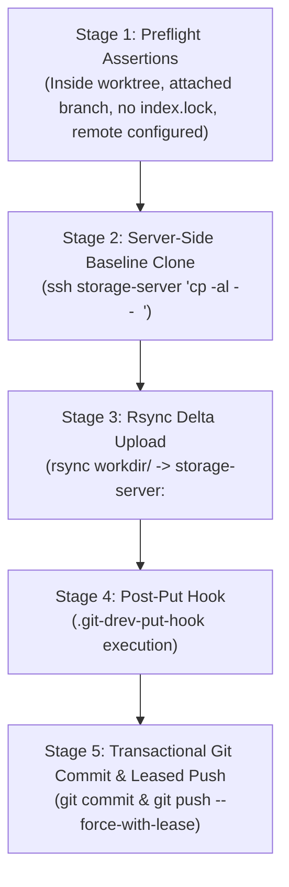

# Chapter 3: The revision lifecycle

This chapter covers the day-to-day lifecycle of directory revisions in `git-drev`: creating revision branches, publishing snapshots, switching between historical versions, and synchronizing updates.

---

## 1. Revision anatomy & metadata format

Unlike standard Git commits that store tracked directory tree blobs, `git-drev` revision commits are lightweight metadata records. Each commit subject contains a compact single-line JSON payload:

```json
{"uuid":"4a123f89-8d7b-4b10-8f6a-49321ef19b12","seq":"1729348200"}
```

- **`uuid`:** RFC 4122 canonical UUID identifying the directory snapshot stored at `<remote.path>/<uuid>` on the storage host.
- **`seq`:** Monotonically increasing unsigned 64-bit integer serialized as a decimal string. When `-s` (`--sequence`) is not explicitly passed to `git drev put`, `seq` defaults to the current Unix epoch timestamp in seconds (or can be set to an explicit CI build number via `-s <uint64>`).
- **Marker commits:** When a branch is first initialized via `git drev create`, an initial marker commit is created:
  ```json
  {"uuid":"4a123f89-8d7b-4b10-8f6a-49321ef19b12","marker":"true"}
  ```
  The marker stores the parent revision's UUID (or `00000000-0000-0000-0000-000000000000` if no parent revision exists) to establish the baseline linkage for future `cp -al --` server clones.

---

## 2. Creating a revision branch (`create`)

Before publishing revisions for a new release or feature, initialize a branch:

```bash
git drev create release/2.0
```

### What happens under the hood
1. **Local check:** Checks if `refs/heads/release/2.0` already exists locally. If so, checks it out idempotently.
2. **Remote check:** Checks if `refs/remotes/origin/release/2.0` exists on `origin`. If so, creates a local tracking branch and switches to it.
3. **New branch initialization:** If the branch does not exist anywhere:
   - Reads the UUID of the current `HEAD` commit (or `00000000-0000-0000-0000-000000000000` if none).
   - Creates an empty marker commit (`{"uuid":"<parent-uuid>","marker":"true"}`) on the new branch.
   - Pushes the new branch and marker commit to `origin`.

```
* (release/2.0) [Marker Commit: {"uuid":"4a123f89-...","marker":"true"}]
|
* (main) [Revision: {"uuid":"4a123f89-...","seq":"1729348200"}]
```

---

## 3. Publishing revisions (`put`)

`put` uploads the contents of `workdir` (or an optional `<source_directory>`) to the remote storage host and commits the new revision metadata to Git:

```bash
# Populate or update your build output in workdir/
make build-all-artifacts

# Publish the revision (defaults sequence to current Unix epoch seconds)
git drev put

# Or pass an explicit monotonic CI build number and print rsync transfer stats
git drev put -s "${BUILD_NUMBER}" --stats
```

### The 5-stage publishing flow



1. **Preflight assertions:** Verifies that `HEAD` is attached to a valid branch, no `.git/index.lock` exists, and `remote.host` / `remote.path` are configured.
2. **Server-side hardlink clone:**
   - If a parent revision UUID exists on the branch (and is not a marker commit or `ZeroUUID`), `git-drev` executes `cp -al -- <parent_uuid> <new_uuid>` directly on the remote server.
   - This creates a hardlinked baseline of the previous build in milliseconds without consuming extra data blocks.
3. **Rsync delta upload:**
   - Runs `rsync` from your local `workdir` (or `<source_directory>`) to the remote `<path>/<new_uuid>/` directory.
   - Only new or modified files and byte ranges are transmitted over the network. Unmodified files remain hardlinked.
4. **Project hook execution:**
   - If `.git-drev-put-hook` exists in the repository root, it runs with `GIT_DREV_*` environment variables injected (see [Chapter 4](04-hooks-and-ci.md)).
5. **Transactional commit & push:**
   - Stages any metadata files modified in the repository root (`git add --all`) and records the revision commit in Git.
   - Pushes to `origin` using `--force-with-lease`.
   - **Sequence-aware stale-push resolution:** If another builder pushed concurrently:
     - If the remote commit has a strictly newer sequence (`remoteSeq > localSeq`) and `--no-sequence-check` is not set, `git-drev` drops the older local commit and hard-resets to `origin/<branch>`.
     - Otherwise, `git-drev` rebases with `--strategy-option=theirs` onto `origin/<branch>` and retries the push (up to 5 attempts).

---

## 4. Switching revisions (`select`)

`select` fetches from `origin` and checks out an existing branch, tag, or specific historical revision commit resolved by UUID:

```bash
# Select by branch name
git drev select feature/embedded-ui

# Select default branch (configured in .git-drev.yaml, default 'main')
git drev select

# Select by exact revision UUID (detaches HEAD to the specific commit)
git drev select 4a123f89-8d7b-4b10-8f6a-49321ef19b12
```

> [!NOTE]
> `git drev select` switches the Git reference only. Run `git drev get` afterward to synchronize `workdir/` with the selected revision's files.

### Typo suggestions
If you make a typo when entering a branch or tag name, `git-drev` computes the Levenshtein distance against existing branches and tags and suggests the closest candidate:

```
$ git drev select featrue/login
[git-drev] Error: Checkout failed (git checkout featrue/login)
[git-drev] Hint: Did you mean 'feature/login'?
```

---

## 5. Downloading snapshot content (`get`)

`get` downloads the remote directory snapshot referenced by the current `HEAD` commit into `workdir` (or an optional `<target_directory>`):

```bash
# Download the snapshot for the currently checked-out commit
git drev get

# Update the current branch from origin AND download the latest snapshot in one step
git drev get --latest

# Download into a custom directory with rsync transfer statistics
git drev get --stats ./custom-output
```

---

## 6. Synchronizing branch metadata (`update`)

`update` synchronizes the active local Git branch with `origin/<branch>` **without** downloading the remote directory payload:

```bash
git drev update
```

### What happens under the hood
1. Verifies that `HEAD` is attached to a local branch.
2. Ensures `+refs/heads/*:refs/remotes/origin/*` is configured on `remote.origin.fetch`.
3. Executes `git fetch --all --prune`.
4. Hard-resets the local branch to `refs/remotes/origin/<branch>`.

> [!TIP]
> Use `git drev update` when you want to inspect the latest commit metadata or run `git drev info` before downloading multi-gigabyte files, or on a Producer node before starting a new build. To update the branch **and** download the files into `workdir` in a single command, use `git drev get --latest` (`-l`).

---

## 7. Inspecting revisions & storage status

### Custom revision info (`info`)
Executes the repository's `.git-drev-info-hook` script (if present) with `GIT_DREV_*` metadata variables injected so your project can print formatted build details, test results, or artifact manifests:

```bash
git drev info
```
If no `.git-drev-info-hook` is present in the repository root, `git drev info` logs `[git-drev] No info hook found` to `stderr` and exits `0`.

### Current branch name (`name`)
Prints the current branch name to `stdout` (or fails with exit code `4` if `HEAD` is detached):
```bash
git drev name
# release/2.0
```

### Remote storage usage (`usage`)
Queries the remote storage host via SSH (`du -sh`) to report total disk space consumed by stored revisions:
```bash
git drev usage
```
Add `-v` (`--verbose`) to correlate all remote UUID directories against local Git history, revealing active versus `[orphaned]` snapshots:
```bash
git drev usage -v
```
Output:
```
Total size on remote is 8.1G (/srv/drev/my-project)

UUID                                  Size  Created     Commit      Branch/Tag    Message
4a123f89-8d7b-4b10-8f6a-49321ef19b12  4.2G  2026-10-19  a7b8c9d     release/2.0   {"uuid":"4a123f89-8d7b-4b10-8f6a-49321ef19b12","seq":"200"}
9f8e7d6c-5b4a-3a21-10fe-dcba98765432  120M  2026-10-18  1f2e3d4     main, v1.0.1  {"uuid":"9f8e7d6c-5b4a-3a21-10fe-dcba98765432","seq":"100"}
01234567-89ab-cdef-0123-456789abcdef  3.8G  2026-10-15  [orphaned]  -             -
```
*(See [Chapter 5: Storage architecture & retention](05-storage-and-retention.md) for automated cleanup of orphaned revisions).*
