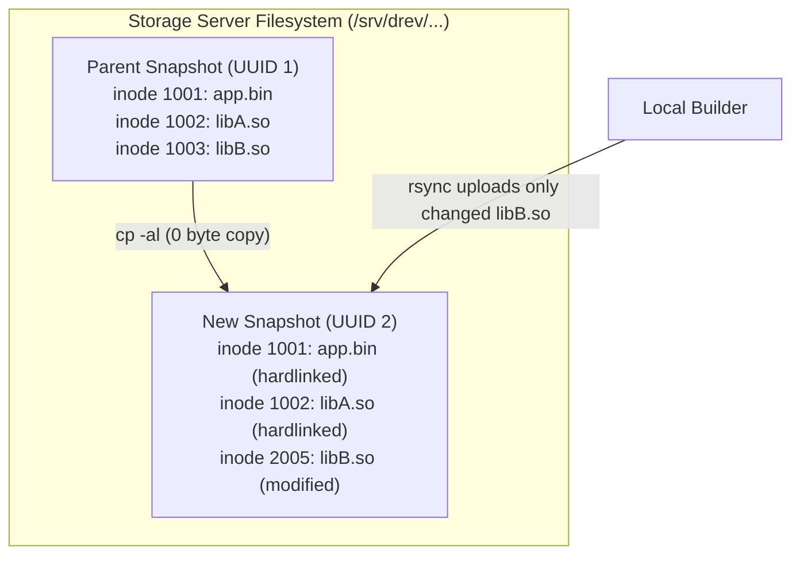

# Chapter 5: Storage Architecture and Retention Management

This chapter explains how `git-drev` structures files on the remote storage host, how hardlink baseline cloning eliminates storage duplication, and how to safely manage storage retention and clean up orphaned revisions.

---

## 1. Remote Storage Layout

On the remote storage host specified in `.git-drev.yaml` (`remote.host` and `remote.path`), revisions are stored in flat subdirectories named after their respective RFC 4122 UUIDs:

```
/srv/drev/my-project/
├── 4a123f89-8d7b-4b10-8f6a-49321ef19b12/   # Revision UUID (release/1.0, seq 1)
│   ├── bin/
│   ├── lib/
│   └── assets/
├── 9f8e7d6c-5b4a-3a21-10fe-dcba98765432/   # Revision UUID (release/1.0, seq 2)
│   ├── bin/
│   ├── lib/
│   └── assets/
└── d4e5f6a7-b8c9-0123-4567-89abcdef0123/   # Revision UUID (main, seq 1)
    ├── bin/
    └── lib/
```

### Why Flat UUID Directories?
1. **Branch-Agnostic Deduplication:** Multiple branches can branch off each other without path nesting or conflicts.
2. **Immutable Integrity:** Once published, a UUID directory is treated as read-only.
3. **Safe Concurrency:** Builders targeting different branches or revisions operate on independent UUID targets without locking collisions.

---

## 2. Hardlink Baseline Cloning (`cp -al`)

The primary innovation of `git-drev` for large builds is **server-side baseline cloning**:



When publishing a revision whose branch has a parent commit:
1. `git drev put` invokes `cp -al <parent_uuid> <new_uuid>` on the remote storage host via SSH.
2. The operating system creates hard links for all files in the parent directory. This operation completes in milliseconds and consumes **zero additional disk blocks** (only standard filesystem directory inodes).
3. `rsync` uploads the builder's changes into `<new_uuid>`. When `rsync` replaces a changed file, it breaks the hardlink for that specific file and writes the new blocks. Unchanged files continue sharing storage inodes with the parent snapshot.

---

## 3. Rsync Configuration & Tuning

The `remote.rsync` parameter in `.git-drev.yaml` controls flags passed to `rsync` during upload (`put`) and download (`get`, `update`):

```yaml
remote:
  host: storage-server
  path: /srv/drev/my-project
  rsync: -aHAX --info=progress2 --delete-during
```

### Recommended Flags Explained
- `-a` (`--archive`): Recursively preserves file permissions, timestamps, symlinks, and directory hierarchies.
- `-H` (`--hard-links`): Preserves internal hardlinks within the snapshot.
- `-A` (`--acls`): Preserves POSIX Access Control Lists.
- `-X` (`--xattrs`): Preserves extended file attributes (vital for SELinux contexts or macOS metadata).
- `--delete-during`: Deletes files from the target that no longer exist in the source while minimizing memory overhead on large file trees.
- `--info=progress2`: Displays real-time transfer progress for the overall transfer rather than per-file spam.

---

## 4. Auditing Storage with `git drev usage`

To check storage consumption, run:

```bash
git drev usage
```
This queries the remote host via `ssh` and prints the total disk space utilized by `<remote.path>`.

### Correlating Active vs. Orphaned Revisions (`-v`)
When developers delete old Git branches, force-push rebases, or delete tags, some remote UUID directories may no longer be referenced by any Git commit in repository history. These are **orphaned revisions**.

Running `git drev usage -v` scans your Git commit history and compares every known UUID against directories on the remote host:

```bash
git drev usage -v
```

Example Output:
```
UUID                                  Size      State       Branch / Tag
------------------------------------  --------  ----------  -------------------
4a123f89-8d7b-4b10-8f6a-49321ef19b12  4.2 GB    active      release/1.0
9f8e7d6c-5b4a-3a21-10fe-dcba98765432  120 MB    active      main, v1.0.1
01234567-89ab-cdef-0123-456789abcdef  3.8 GB    [orphaned]  (no git ref)
------------------------------------  --------  ----------  -------------------
Total Storage Consumed: 8.12 GB (3 revisions)
Orphaned Storage:       3.8 GB (1 revision)
```

---

## 5. Automated Retention Management

To reclaim disk space consumed by orphaned revisions, run an automated retention cleanup script on the storage host or via CI.

### Server-Side Retention Cleanup Script (`cleanup.sh`)
Deploy this script to your storage server to clean up orphaned directories:

```bash
#!/usr/bin/env bash
# cleanup.sh - Clean up orphaned git-drev revisions
set -euo pipefail

STORAGE_PATH="/srv/drev/my-project"
GIT_REPO_PATH="/srv/git/my-project.git"

echo "=== Starting git-drev retention cleanup ==="

# 1. Extract all valid revision UUIDs referenced across all Git commits
mapfile -t VALID_UUIDS < <(
  git --git-dir="${GIT_REPO_PATH}" log --all --format=%s \
    | grep -oE '[0-9a-fA-F]{8}-[0-9a-fA-F]{4}-[0-9a-fA-F]{4}-[0-9a-fA-F]{4}-[0-9a-fA-F]{12}' \
    | sort -u
)

echo "Found ${#VALID_UUIDS[@]} active revision UUIDs in Git history."

# 2. Iterate through physical directories on the storage host
for dir in "${STORAGE_PATH}"/*; do
  [[ -d "${dir}" ]] || continue
  uuid=$(basename "${dir}")

  # Check if directory name is a valid UUID
  if [[ "${uuid}" =~ ^[0-9a-fA-F]{8}-[0-9a-fA-F]{4}-[0-9a-fA-F]{4}-[0-9a-fA-F]{4}-[0-9a-fA-F]{12}$ ]]; then
    # Check if UUID exists in the valid list
    if ! printf '%s\n' "${VALID_UUIDS[@]}" | grep -qi "^${uuid}$"; then
      echo "Removing orphaned revision: ${uuid}"
      rm -rf "${dir}"
    fi
  fi
done

echo "=== Cleanup completed successfully ==="
```

### Scheduling with Cron
Set up a weekly cron job on the storage server:

```cron
# Run retention cleanup every Sunday at 03:00 AM
0 3 * * 0 /usr/local/bin/drev-cleanup.sh >> /var/log/drev-cleanup.log 2>&1
```
