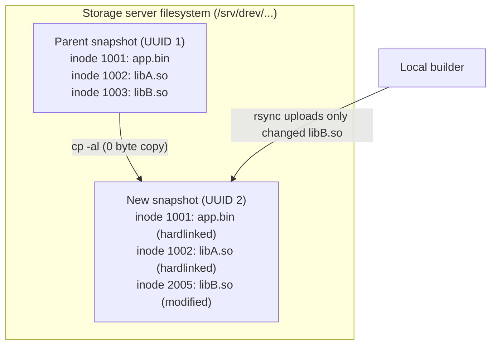
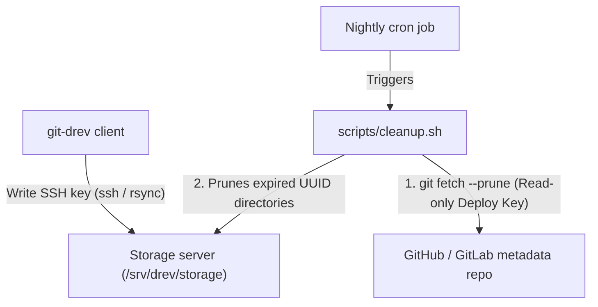

# Chapter 5: Storage architecture and retention management

This chapter explains how `git-drev` structures files on the remote storage host, how hardlink baseline cloning eliminates storage duplication, and how to safely manage storage retention and clean up orphaned revisions.

---

## 1. Remote storage layout

On the remote storage host specified in `.git-drev.yaml` (`remote.host` and `remote.path`), revisions are stored in flat subdirectories named after their respective RFC 4122 UUIDs:

```
/srv/drev/my-project/
├── 4a123f89-8d7b-4b10-8f6a-49321ef19b12/   # Revision UUID (release/1.0, seq 1)
│   ├── bin/
│   ├── lib/
│   └── assets/
├── 9f8e7d6c-5b4a-3a21-10fe-dcba98765432/   # Revision UUID (release/1.0, seq 2)
│   ├── bin/
│   ├── lib/
│   └── assets/
└── d4e5f6a7-b8c9-0123-4567-89abcdef0123/   # Revision UUID (main, seq 1)
    ├── bin/
    └── lib/
```

### Why flat UUID directories?
1. **Branch-agnostic deduplication:** Multiple branches can branch off each other without path nesting or conflicts.
2. **Immutable integrity:** Once published, a UUID directory is treated as read-only.
3. **Safe concurrency:** Builders targeting different branches or revisions operate on independent UUID targets without locking collisions.

---

## 2. Hardlink baseline cloning (`cp -al`)

`git-drev` minimizes remote storage growth through **server-side baseline cloning**:



When publishing a revision whose branch has a parent commit:
1. `git drev put` invokes `cp -al -- <parent_uuid> <new_uuid>` on the remote storage host via SSH.
2. The operating system creates hard links for all files in the parent directory. This operation completes in milliseconds and consumes **zero additional disk blocks** (only standard filesystem directory entries).
3. `rsync` uploads the builder's changes into `<new_uuid>`. By default, when `rsync` transfers a modified file, it writes the updated payload to a temporary file (`.filename.XXXXXX`) in a new inode and atomically `rename()`s it over the destination path—cleanly breaking the hardlink for that specific file without mutating the parent revision. Unchanged files continue sharing storage inodes with the parent snapshot.

> [!WARNING]
> **Why `--inplace`, `--append`, and `--append-verify` are prohibited on `put`:**
> If `rsync` were invoked with `--inplace`, `--append`, or `--append-verify`, it would write directly into the existing destination inode and silently mutate historical revisions that share that hardlink. To protect revision immutability, `git-drev` automatically validates `remote.rsync.put` and rejects those flags with a configuration error (`ExitCode 3`).

---

## 3. Rsync configuration & tuning

The `remote.rsync` section in `.git-drev.yaml` configures custom flags appended to `rsync` during download (`get`) and upload (`put`):

```yaml
remote:
  host: storage-server
  path: /srv/drev/my-project
  rsync:
    get: -c
    put: -c
```

> [!IMPORTANT]
> **Choosing whether to include `-c` (`--checksum`):**
> `git-drev` does not hardcode `-c` by default because checksummed transfers must read every file of matching size from disk on both client and server. Choose based on how your files are produced:
> - **CI / clean builds & unpacked archives (`get: -c`, `put: -c` — recommended):** Clean builds and archive unpackers (`tar`, `zip`, Maven/Gradle/Tycho) update the modification timestamp (`mtime`) of every output file even when 80–95% of the compiled `.jar`s, libraries, or assets are byte-for-byte identical. Without `-c`, `rsync` treats every file with a newer timestamp as modified, re-transfers it, and replaces the file on the remote host—**breaking the `cp -al` hardlinks** created during baseline cloning and eliminating storage deduplication.
> - **Incremental local builds & static datasets (omit `-c`):** If your workflow preserves `mtime` on unchanged files (or manages multi-gigabyte media trees where reading every file to compute checksums is too slow), omit `-c` so `rsync` uses its fast `(size, mtime)` check.

### Implicit & recommended flags explained
`git-drev` always passes `-a --delete-during -e "ssh -T"` before appending your custom `get` or `put` options:
- `-a` (`--archive`, *implicit*): Recursively preserves file permissions, timestamps, symlinks, and directory hierarchies.
- `--delete-during` (*implicit*): Deletes files from the target that no longer exist in the source while minimizing memory overhead on large file trees.
- `-c` (`--checksum`, *strongly recommended*): Compares file checksums rather than `(size, mtime)` so byte-identical files with newer build timestamps are skipped over the wire and keep their `cp -al` hardlinks on the server.
- `-z` (`--compress`): Compresses file data during network transfer.
- `-H` (`--hard-links`): Preserves internal hardlinks within the snapshot.
- `-A` (`--acls`): Preserves POSIX Access Control Lists.
- `-X` (`--xattrs`): Preserves extended file attributes (useful for SELinux contexts or macOS metadata).
- `--whole-file`: Speeds up local-LAN or high-bandwidth server uploads after `cp -al` when modified build artifacts are completely regenerated.

---

## 4. Auditing storage with `git drev usage`

To check storage consumption, run:

```bash
git drev usage
```
This queries the remote host via `ssh` and prints the summary of disk space utilized by `<remote.path>`:
```text
Summary:
  Remote storage:    storage-server:/srv/drev/my-project
  Total space used:  8.1G
  Revisions found:   3
```

### Correlating active vs. orphaned revisions (`-a`)
When developers delete old Git branches, drop older concurrent builds, or delete tags, some remote UUID directories may no longer be referenced by any Git commit in repository history. These are **orphaned revisions**.

Running `git drev usage -a` (`--all`) scans your Git commit history (`git log --all`) and correlates every known UUID against directories on the remote host:

```bash
git drev usage -a
```

Example output:
```text
Summary:
  Remote storage:    storage-server:/srv/drev/my-project
  Total space used:  8.1G
  Revisions found:   3

Revisions breakdown:
UUID                                      Size  Created              Commit      Branch/Tag            Message
------------------------------------  --------  -------------------  ----------  --------------------  ----------------------
4a123f89-8d7b-4b10-8f6a-49321ef19b12      4.2G  2026-10-19 14:22:10  a7b8c9d     release/1.0           seq: 200
9f8e7d6c-5b4a-3a21-10fe-dcba98765432      120M  2026-10-18 09:15:00  1f2e3d4     main, v1.0.1          seq: 100
01234567-89ab-cdef-0123-456789abcdef      3.8G  2026-10-15 18:04:12  [orphaned]  -                     -
```

---

## 5. Automated retention management

Because hardlinks are reference-counted by the filesystem kernel, running `rm -rf` on an old `<uuid>` directory is completely safe: any inode still referenced by a newer revision remains intact on disk, and disk blocks are freed only when the last revision pointing to an inode is removed. Even when an old binary directory is pruned on the storage server, its metadata commit and any tracked build logs or manifests remain in Git history permanently.

Because retention policies vary across teams and projects, `git-drev` provides a ready-to-use, customizable server-side script in [`scripts/cleanup.sh`](../../scripts/cleanup.sh).

### Retention rules in [`scripts/cleanup.sh`](../../scripts/cleanup.sh)
The script inspects a bare clone of your Git metadata repository on the storage server and applies the following rules:
1. **Last $N$ commits per open branch (`--commits`, default: `5`):** Always retains the latest $N$ commits on every active branch (`refs/heads/*` and `refs/remotes/*`), guaranteeing that even dormant branches keep their recent snapshots and `cp -al` baselines.
2. **Sliding time window (`--days`, default: `30`):** Retains all commits authored within the last $M$ days on any active branch.
3. **Tagged releases:** Never deletes revision directories referenced by any Git tag (both lightweight and annotated tags). Only the tagged commits themselves are pinned (`git rev-list --no-walk --tags`), allowing older untagged builds before a release tag to age out normally.
4. **Branch marker baselines:** If a newly created branch (`git drev create`) only has an initial marker commit (`{"uuid":"<parent_uuid>","marker":"true"}`), the script protects `<parent_uuid>` so the branch's server-side baseline is never deleted before its first `git drev put`.
5. **Deleted branches & orphans:** Once a branch is deleted in Git, its commits are automatically dropped from the keep list and purged on the next cleanup run (unless retained by another active branch or tag).

### CLI usage
```bash
./scripts/cleanup.sh [options] <git-dir> <storage-dir>
```

| Flag | Default | Description |
| :--- | :--- | :--- |
| `-n`, `--dry-run` | `false` | Preview which revision directories would be deleted without modifying the filesystem. |
| `-d`, `--days <N>` | `30` | Retain all commits from the last `<N>` days on open branches (`0` to disable time window). |
| `-c`, `--commits <N>` | `5` | Retain the latest `<N>` commits on each open branch (`0` to disable commit count window). |
| `-h`, `--help` | - | Display usage and cron configuration instructions. |

---

### Step-by-step server setup (GitHub / GitLab + Cron)

When your metadata repository is hosted on GitHub or GitLab, configure your storage server with a **dedicated read-only Deploy Key** so a nightly cron job can fetch branch/tag updates and run [`scripts/cleanup.sh`](../../scripts/cleanup.sh) without sharing client write credentials:



#### Step 1: Generate a dedicated read-only SSH key on the storage server
Log in to your storage server and generate a passphrase-less key dedicated to fetching metadata:
```bash
ssh-keygen -t ed25519 -f ~/.ssh/github_drev_readonly -N "" -C "git-drev-server-cleanup"
```

#### Step 2: Register the public key as a read-only Deploy Key
1. Display the public key:
   ```bash
   cat ~/.ssh/github_drev_readonly.pub
   ```
2. In your GitHub metadata repository, navigate to **Settings → Deploy keys → Add deploy key**.
3. Paste the public key and **leave "Allow write access" unchecked** so the storage server has strictly read-only access to Git metadata.

#### Step 3: Configure an SSH host alias on the storage server
Add a host alias to `~/.ssh/config` on the storage server so `git fetch` uses the read-only deploy key:
```ssh-config
Host github.com-drev
    HostName github.com
    User git
    IdentityFile ~/.ssh/github_drev_readonly
    IdentitiesOnly yes
```

#### Step 4: Create a bare clone of the metadata repository
Clone the metadata repository onto the storage server using the SSH host alias:
```bash
git clone --bare git@github.com-drev:myorg/myproject-meta.git /srv/drev/myproject-meta.git
```

#### Step 5: Verify with `--dry-run` and schedule via Cron
First, test the fetch and cleanup in dry-run mode:
```bash
git --git-dir=/srv/drev/myproject-meta.git fetch origin '+refs/heads/*:refs/heads/*' --prune --tags
/srv/drev/cleanup.sh --dry-run --days 30 --commits 5 /srv/drev/myproject-meta.git /srv/drev/storage/myproject
```

Then add a nightly job to `crontab -e`:
```cron
# Fetch pruned branches/tags and purge expired revisions every night at 02:00 AM
0 2 * * * git --git-dir=/srv/drev/myproject-meta.git fetch origin '+refs/heads/*:refs/heads/*' --prune --tags && /srv/drev/cleanup.sh --days 30 --commits 5 /srv/drev/myproject-meta.git /srv/drev/storage/myproject >> /var/log/git-drev-cleanup.log 2>&1
```

> [!TIP]
> **Why Separate SSH Keys Matter:** Clients connect to the storage server using their SSH keys in `authorized_keys`, while the storage server connects outbound to GitHub using its read-only deploy key (`github_drev_readonly`). Rotating or revoking a developer's SSH key on the storage server never disrupts automated retention cleanup.

---

## 6. Real-world benchmark: Eclipse SDK builds

To measure end-to-end transfer speed and server-side storage deduplication on real software distributions, we benchmarked **5 consecutive daily [Eclipse SDK integration builds (`I-builds`)](https://download.eclipse.org/eclipse/downloads/)** (`linux-gtk-x86_64`, `I20261015-2300` through `I20261019-2300`):
- Each build archive is **273.0 MiB** compressed (`.tar.gz`) and unpacks to **302.7 MiB** (**306M** on disk across **1,368 files**, mostly OSGi `.jar` bundles and native libraries).
- Between consecutive daily builds, **~81% of files (1,091–1,124 files, ~262 MiB)** are byte-for-byte identical, while only **244–277 files (19–56 MiB)** actually change.
- **Test environment:** Linux `x86_64` client and remote storage server connected over a 1 Gbps LAN with `rsync -c` (`--checksum`) enabled.

### Headline comparison (5 daily builds)

| Metric | Traditional (`curl` + `tar -xzf`) | `git-drev` (`select` + `get` / `put`) | Improvement |
| :--- | :--- | :--- | :--- |
| **Avg. daily update time (Consumer)** | `25.92s` (download + extract) | **`2.19s`** (`git drev select` + `get`) | **11.8x faster** |
| **Total sync time across all 5 builds** | `123.75s` (5 full downloads) | **`13.61s`** (1 cold + 4 incremental) | **9.1x faster** |
| **Avg. network payload per daily update** | `272.99 MiB` (full `.tar.gz`) | **`35.12 MiB`** (changed files/deltas only) | **87.1% less traffic** |
| **Server disk space for 5 unpacked builds** | `1,530 MB` (`5 × 306 MB` unpacked) | **`483 MB`** (`cp -al` hardlinked storage) | **68.4% less storage (`3.17x` dedup)** |
| **Server disk space vs. 5 `.tar.gz` archives** | `1,365 MB` (`5 × 273 MB` compressed) | **`483 MB`** (immediately usable directories) | **65.0% less storage than `.tar.gz`** |

### Per-build breakdown

| Build ID | Unpacked size (files) | Baseline: Download + Extract | Producer: `git drev put` (sent) | Consumer: `git drev select` + `get` (received) | Consumer speedup |
| :--- | :--- | :--- | :--- | :--- | :--- |
| `I20261015-2300` *(Cold)* | `302.7 MiB` (1,368) | `19.10s` + `0.98s` = **`20.08s`** | `5.77s` (`302.9 MiB`, 1,368 files) | **`4.84s`** (`302.9 MiB`, 1,368 files) | **4.1x faster** |
| `I20261016-2300` *(Delta)* | `302.7 MiB` (1,368) | `34.89s` + `1.01s` = **`35.90s`** | `2.40s` (`31.7 MiB`, 272 files) | **`2.15s`** (`31.7 MiB`, 272 files) | **16.7x faster** |
| `I20261017-2300` *(Delta)* | `302.7 MiB` (1,368) | `14.68s` + `0.99s` = **`15.67s`** | `2.41s` (`33.5 MiB`, 260 files) | **`2.16s`** (`33.5 MiB`, 260 files) | **7.3x faster** |
| `I20261018-2300` *(Delta)* | `302.7 MiB` (1,368) | `37.41s` + `0.99s` = **`38.40s`** | `2.17s` (`19.1 MiB`, 244 files) | **`2.03s`** (`19.1 MiB`, 244 files) | **18.9x faster** |
| `I20261019-2300` *(Delta)* | `302.7 MiB` (1,368) | `12.74s` + `0.97s` = **`13.71s`** | `2.71s` (`56.3 MiB`, 277 files) | **`2.43s`** (`56.2 MiB`, 277 files) | **5.6x faster** |
| **Total / Cumulative** | **`1,513.4 MiB`** (6,840) | **`123.75s`** (`1,364.9 MiB` `.tar.gz`) | **`15.47s`** (`443.5 MiB` total sent) | **`13.61s`** (`443.4 MiB` total received) | **9.1x faster** |

### Remote storage deduplication (`git drev usage -a`)

Even though all 5 revisions are stored as full, unpacked **306M** directory trees on the remote SSH server, `cp -al` hardlink cloning deduplicates unchanged files across revisions so the entire 5-build history consumes only **483M** on disk:

```text
$ git drev usage -a
Summary:
  Remote storage:    drs:/volume1/storage_drs/data/git-drev-benchmark
  Total space used:  483M
  Revisions found:   5

Revisions breakdown:
UUID                                      Size  Created              Commit      Branch/Tag            Message
------------------------------------  --------  -------------------  ----------  --------------------  ----------------------
0f6d2793-d87d-4dcc-9dd3-eec67425cdcf      306M  2026-10-17 01:13:29  58000a4     -                     seq: 2
62ec298a-ed76-449b-b922-76be5f584e86      306M  2026-10-20 01:12:34  4d1b2c9     main, origin/main     seq: 5
79aeba02-49df-48d9-85a1-208c3b78db77      306M  2026-10-19 01:12:05  aa5a9b9     -                     seq: 4
c5e956ec-cfcd-48e2-88f7-c7fa8f85eb8c      306M  2026-10-16 01:14:04  d78f5e8     -                     seq: 1
fe6453a6-6ba5-49c4-9821-baed6b995c18      306M  2026-10-18 01:12:36  ffc680b     -                     seq: 3
```
