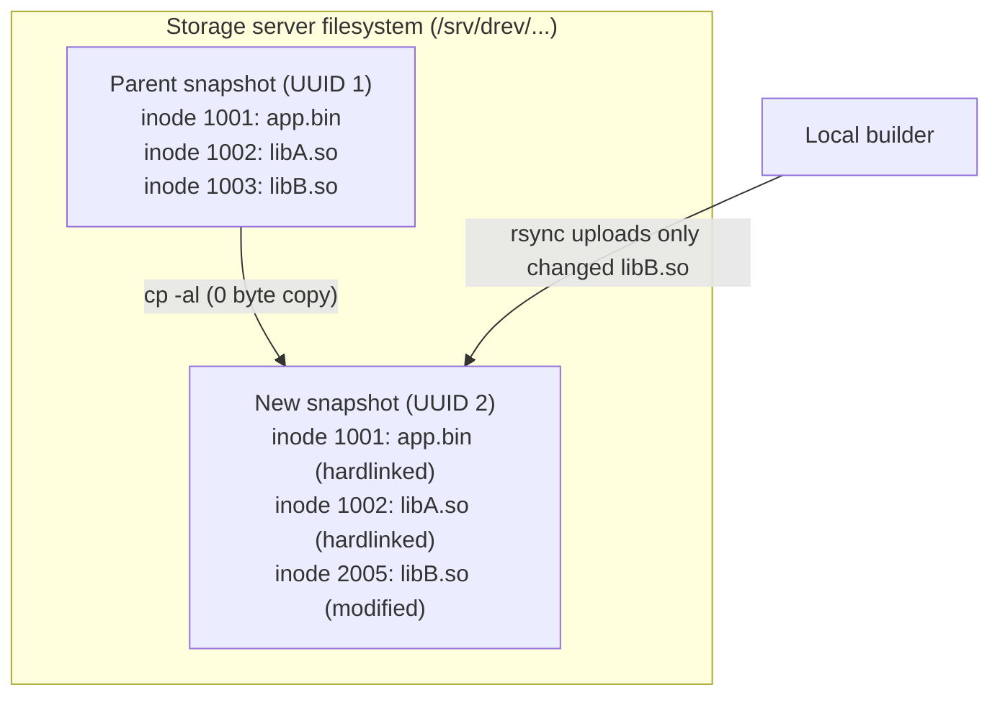

# Chapter 5: Storage architecture and retention management

This chapter explains how `git-drev` structures files on the remote storage host, how hardlink baseline cloning eliminates storage duplication, and how to safely manage storage retention and clean up orphaned revisions.

---

## 1. Remote storage layout

On the remote storage host specified in `.git-drev.yaml` (`remote.host` and `remote.path`), revisions are stored in flat subdirectories named after their respective RFC 4122 UUIDs:

```
/srv/drev/my-project/
├── 4a123f89-8d7b-4b10-8f6a-49321ef19b12/   # Revision UUID (release/1.0, seq 1)
│   ├── bin/
│   ├── lib/
│   └── assets/
├── 9f8e7d6c-5b4a-3a21-10fe-dcba98765432/   # Revision UUID (release/1.0, seq 2)
│   ├── bin/
│   ├── lib/
│   └── assets/
└── d4e5f6a7-b8c9-0123-4567-89abcdef0123/   # Revision UUID (main, seq 1)
    ├── bin/
    └── lib/
```

### Why flat UUID directories?
1. **Branch-agnostic deduplication:** Multiple branches can branch off each other without path nesting or conflicts.
2. **Immutable integrity:** Once published, a UUID directory is treated as read-only.
3. **Safe concurrency:** Builders targeting different branches or revisions operate on independent UUID targets without locking collisions.

---

## 2. Hardlink baseline cloning (`cp -al`)

`git-drev` minimizes remote storage growth through **server-side baseline cloning**:



When publishing a revision whose branch has a parent commit:
1. `git drev put` invokes `cp -al -- <parent_uuid> <new_uuid>` on the remote storage host via SSH.
2. The operating system creates hard links for all files in the parent directory. This operation completes in milliseconds and consumes **zero additional disk blocks** (only standard filesystem directory entries).
3. `rsync` uploads the builder's changes into `<new_uuid>`. By default, when `rsync` transfers a modified file, it writes the updated payload to a temporary file (`.filename.XXXXXX`) in a new inode and atomically `rename()`s it over the destination path—cleanly breaking the hardlink for that specific file without mutating the parent revision. Unchanged files continue sharing storage inodes with the parent snapshot.

> [!WARNING]
> **Why `--inplace`, `--append`, and `--append-verify` are prohibited on `put`:**
> If `rsync` were invoked with `--inplace`, `--append`, or `--append-verify`, it would write directly into the existing destination inode and silently mutate historical revisions that share that hardlink. To protect revision immutability, `git-drev` automatically validates `remote.rsync.put` and rejects those flags with a configuration error (`ExitCode 3`).

---

## 3. Rsync configuration & tuning

The `remote.rsync` section in `.git-drev.yaml` configures custom flags appended to `rsync` during download (`get`) and upload (`put`):

```yaml
remote:
  host: storage-server
  path: /srv/drev/my-project
  rsync:
    get: -cz --stats
    put: -cz --whole-file --stats
```

> [!IMPORTANT]
> **Always use `-c` (`--checksum`) when build systems regenerate file timestamps:**
> By default, `rsync -a` uses a fast `(size, mtime)` check to decide whether a file has changed. However, most CI pipelines, clean builds, and archive unpackers (`tar`, `zip`, Maven/Gradle/Tycho) update the modification timestamp (`mtime`) of every output file—even when 80–95% of the compiled `.jar`s, libraries, or assets are byte-for-byte identical to the previous build.
>
> Without `-c` (`--checksum`), `rsync` treats every file with a newer timestamp as modified, re-transfers it, and replaces the file on the remote host—**breaking the `cp -al` hardlinks** created during baseline cloning and eliminating storage deduplication. Passing `-c` (`--checksum`) in `remote.rsync.put` and `remote.rsync.get` instructs `rsync` to compare file checksums instead of timestamps, ensuring 100% of byte-identical files retain their shared hardlinked inodes on the server and are skipped over the network.

### Implicit & recommended flags explained
`git-drev` always passes `-a --delete-during -e "ssh -T"` before appending your custom `get` or `put` options:
- `-a` (`--archive`, *implicit*): Recursively preserves file permissions, timestamps, symlinks, and directory hierarchies.
- `--delete-during` (*implicit*): Deletes files from the target that no longer exist in the source while minimizing memory overhead on large file trees.
- `-c` (`--checksum`, *strongly recommended*): Compares file checksums rather than `(size, mtime)` so byte-identical files with newer build timestamps are skipped over the wire and keep their `cp -al` hardlinks on the server.
- `-z` (`--compress`): Compresses file data during network transfer.
- `-H` (`--hard-links`): Preserves internal hardlinks within the snapshot.
- `-A` (`--acls`): Preserves POSIX Access Control Lists.
- `-X` (`--xattrs`): Preserves extended file attributes (useful for SELinux contexts or macOS metadata).
- `--whole-file`: Speeds up local-LAN or high-bandwidth server uploads after `cp -al` when modified build artifacts are completely regenerated.

---

## 4. Auditing storage with `git drev usage`

To check storage consumption, run:

```bash
git drev usage
```
This queries the remote host via `ssh` and prints the total disk space utilized by `<remote.path>`:
```
Total size on remote is 8.1G (/srv/drev/my-project)
```

### Correlating active vs. orphaned revisions (`-v`)
When developers delete old Git branches, drop older concurrent builds, or delete tags, some remote UUID directories may no longer be referenced by any Git commit in repository history. These are **orphaned revisions**.

Running `git drev usage -v` scans your Git commit history (`git log --all`) and correlates every known UUID against directories on the remote host:

```bash
git drev usage -v
```

Example output:
```
Total size on remote is 8.1G (/srv/drev/my-project)

UUID                                  Size  Created     Commit      Branch/Tag    Message
4a123f89-8d7b-4b10-8f6a-49321ef19b12  4.2G  2026-10-19  a7b8c9d     release/1.0   {"uuid":"4a123f89-8d7b-4b10-8f6a-49321ef19b12","seq":"200"}
9f8e7d6c-5b4a-3a21-10fe-dcba98765432  120M  2026-10-18  1f2e3d4     main, v1.0.1  {"uuid":"9f8e7d6c-5b4a-3a21-10fe-dcba98765432","seq":"100"}
01234567-89ab-cdef-0123-456789abcdef  3.8G  2026-10-15  [orphaned]  -             -
```

---

## 5. Automated retention management

Because hardlinks are reference-counted by the filesystem kernel, running `rm -rf` on an old `<uuid>` directory is completely safe: any inode still referenced by a newer revision remains intact on disk, and disk blocks are freed only when the last revision pointing to an inode is removed.

Teams typically combine two retention rules:
1. **Orphan removal:** Delete any `<uuid>` directory not referenced by any commit in Git.
2. **Sliding-window pruning (optional):** Prune binary snapshots for commits older than $N$ days (e.g., 30 days), while **always keeping** the latest commit (`HEAD`) of every branch and every Git tag so active branches always have a valid baseline for `cp -al` and `get`. (Even when an old binary directory is pruned, its commit and any tracked build logs remain in Git forever.)

### Server-side retention cleanup script (`cleanup.sh`)
```bash
#!/usr/bin/env bash
# cleanup.sh - Prune orphaned and expired git-drev revisions while preserving branch tips & tags
set -euo pipefail

STORAGE_PATH="/srv/drev/my-project"
GIT_REPO_PATH="/srv/git/my-project.git"
RETENTION_DAYS="${RETENTION_DAYS:-30}"

echo "=== Starting git-drev retention cleanup (window: ${RETENTION_DAYS} days) ==="

# 1. Collect UUIDs from commits within the retention window PLUS all current branch tips and tags
mapfile -t KEEP_UUIDS < <(
  {
    git --git-dir="${GIT_REPO_PATH}" log --all --since="${RETENTION_DAYS} days ago" --format=%s
    git --git-dir="${GIT_REPO_PATH}" for-each-ref --format='%(subject)' refs/heads/ refs/tags/
  } | grep -oE '[0-9a-fA-F]{8}-[0-9a-fA-F]{4}-[0-9a-fA-F]{4}-[0-9a-fA-F]{4}-[0-9a-fA-F]{12}' \
    | tr '[:upper:]' '[:lower:]' \
    | sort -u
)

echo "Retaining ${#KEEP_UUIDS[@]} active revision UUIDs."

# 2. Remove UUID directories not in KEEP_UUIDS
for dir in "${STORAGE_PATH}"/*; do
  [[ -d "${dir}" ]] || continue
  uuid=$(basename "${dir}" | tr '[:upper:]' '[:lower:]')

  if [[ "${uuid}" =~ ^[0-9a-f]{8}-[0-9a-f]{4}-[0-9a-f]{4}-[0-9a-f]{4}-[0-9a-f]{12}$ ]]; then
    if ! printf '%s\n' "${KEEP_UUIDS[@]}" | grep -qx "${uuid}"; then
      echo "Removing expired/orphaned revision: ${uuid}"
      rm -rf -- "${dir}"
    fi
  fi
done

echo "=== Cleanup completed ==="
```

### Scheduling with cron
Set up a weekly cron job on the storage server:

```cron
# Run retention cleanup every Sunday at 03:00 AM
0 3 * * 0 /usr/local/bin/drev-cleanup.sh >> /var/log/drev-cleanup.log 2>&1
```
